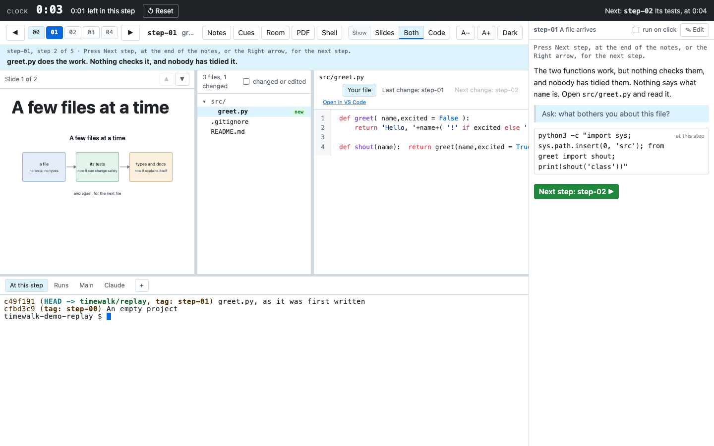

# timewalk

Teach a project through a replay of how its authors built it. timewalk steps through the tags of a
repository one at a time. For each step, it shows your slides, the files as they were, and what the step
changed. It also gives real terminals in the repository at that step.

timewalk serves one page. Open it in a window on the projector and in a window on your own screen. Every
window shows the same step, so what you do on your screen happens on the projector too. With `--notes`,
the page shows the notes of each step beside it, and with `--clock`, a clock across the top.

**Documentation, with screenshots: [rahuldave.com/timewalk](https://rahuldave.com/timewalk/)**



## Try it

```
git clone https://github.com/rahuldave/timewalk
cd timewalk
just demo
```

`just demo` fetches the sample project, [timewalk-demo](https://github.com/rahuldave/timewalk-demo), and
opens it. It prints one address. Open it on the projector and on your own screen. Then take
[the tour of the demo](https://rahuldave.com/timewalk/demo.html). If port 8765 is in use, add
`--port` with another number.

On your own project, run timewalk straight from GitHub with uv. uv downloads it once and keeps it:

```
uvx --from git+https://github.com/rahuldave/timewalk@v1.4.1 timewalk ~/code/project --notes notes.md --slides slides/slides.toml
```

To install the commands `timewalk` and `timewalk-pdf` for good, run
`uv tool install git+https://github.com/rahuldave/timewalk@v1.4.1`.

By default, the steps are the tags that match `step-*`. The message of an annotated tag is the note that
the audience sees, in the status band under the step bar. The band also says what to do now.
Keep the notes file outside the repository. timewalk refuses a notes file inside it.

## What it does

- **Slides and documents** for each step, from a TOML manifest of Markdown slides, pictures, PDF pages
  and longer documents that scroll.
- **A PDF** of the slides, one page each. The notes are for the page, and are not in it. Make it with the **PDF** button
  or with the command `timewalk-pdf`. The command can give the PDF the font, colours, cover page and
  divider pages of a brand, with `--brand`.
- **The files at each step**, with what the step changed.
- **Live edits.** Run `ruff format` at a step, and the page shows what it changed, as it happens.
- **Terminals** at the step, for long runs, in your own repository, and with Claude Code.
- **Notes**, the script of each step, with planned times and commands. A click types a command into its
  terminal. You can edit the notes on the page.
- **Several walks** through one repository, from a table of contents, `toc.toml`. A menu in the step bar
  changes the walk, and `timewalk-check` checks the notes and slides of every walk.
- **Tutorials**, walks that stop at each small commit between two tags. In do mode the learner makes each
  move by hand from the notes, and in watch mode timewalk checks out each commit. `timewalk-notes` drafts
  the notes of each move from its diff. The notes point at the files of a move, and quote its main lines.
  The reader shows the last change and the next one. A `patch$` line in the notes gives a button that
  applies the move's patch to the learner's file.
  A block `::: do` or `::: watch` in the notes shows in one mode only. `timewalk-export` writes a copy
  of a tutorial for each mode, as Markdown for GitHub and as a website, to read without timewalk. With
  `--json`, it writes the facts of a walk in one file, for a class to make its own pages from.
- **Small walks** out of a big tutorial. `select` in `toc.toml` names the steps and moves that a walk
  takes. The walk reads the notes and slides of the whole tutorial. A small tutorial can also have notes of
  its own, with its own words at each stop. Its `{{include step-NN.k}}` lines take the sections of its moves.
- **Shell.** One button, or Alt+Enter, gives the terminals the space of the slides and the files, in every window.
- **Keyboard.** Left and Right change the step, and Up and Down change the slide.
- **GitHub's theme,** light or dark, for the page, the code and the terminals.

## What it will not do to your repository

- **It never moves it, and never writes to it.** timewalk moves a second working copy, `<repo>-replay`, which
  is a git clone on the branch `timewalk/replay`. What a learner commits there stays there, and a move keeps it
  on a saved branch.
- **It never loses an untracked file**, so the outputs of a run stay through every move. If a step has a
  file where an untracked file sits, the move keeps the untracked file on a saved branch first.
- **It never loses an edit, and a move never asks.** Before a move, timewalk keeps the edits on a branch
  `timewalk/saved/<step>` in the replay copy, and the page says how to get them back. With `--in-place`,
  a move with edits asks, and then stashes them.
- **The file view cannot write.** The page writes only the notes file, which lives outside the
  repository.

More in [The replay copy](https://rahuldave.com/timewalk/replay.html) and
[What timewalk does with git](https://rahuldave.com/timewalk/git.html).

## Safety

A terminal in a web page runs commands on your machine. timewalk listens on `127.0.0.1` by default, and
every request needs the token in the address it prints, new at each start. On a cloud machine, use an SSH
tunnel, or `--host 0.0.0.0` with a firewall rule for your own address. **Do not put that address on a
slide or in a recording.** More in [Safety](https://rahuldave.com/timewalk/safety.html).

## If a window stops answering

In a long class, Chrome can stop answering in a window on the projector, often in full screen, and say
that the page is unresponsive. A projector that goes blank and comes back can come first. If a window
stops answering, open the address again in it. The server keeps the step, the slide and the shells. The
window comes back at the same place, with the recent output of each shell. More in
[Teach a class](https://rahuldave.com/timewalk/class.html#if-a-window-stops-answering).

## Requirements

You need `uv`, `git` and a browser. Also install `just` for the recipes, and put `claude` on the path for
the Claude tab. The PDF needs Chrome or Edge. The author checks timewalk in Chrome, and not in Safari or
Firefox.

## Development

```
just test            # the tests
just lint            # ruff
just screenshots     # retake the site's pictures from the demo
just site            # build the site into docs/_site and serve it locally
```

See [Development](https://rahuldave.com/timewalk/development.html). The site's pages are Markdown
in [`docs/`](docs/), published by a GitHub Action.

## Licence

timewalk uses the MIT licence. See [`LICENSE`](LICENSE). The libraries in `src/timewalk/static/vendor/` keep their own
licences, each in its folder. They are ghostty-web (MIT), highlight.js (BSD 3-Clause) and marked (MIT).
