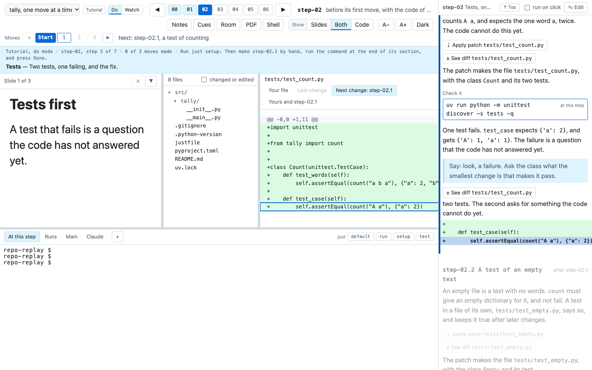
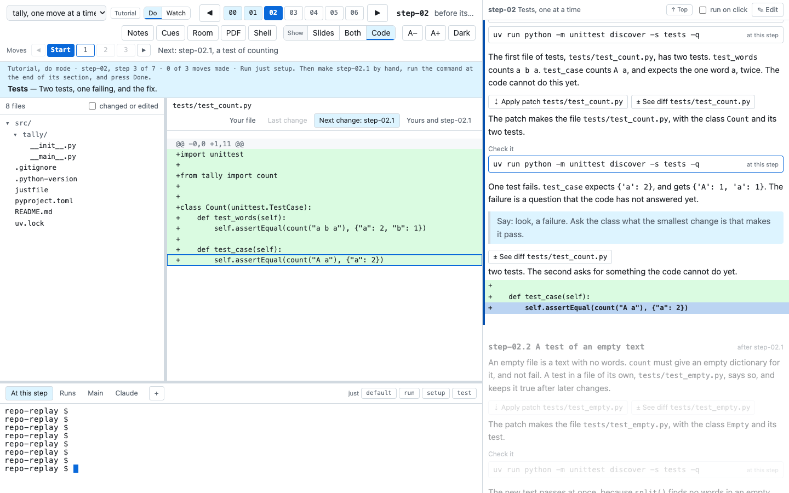

# What a narrative and a tutorial need

This page lists what a walk needs, as checklists. A walk is one path through the history of a project,
with its own notes and slides. A walk is one of two kinds:

- **A narrative** goes from tag to tag. Each tag marks a step.
- **A tutorial** also stops at each small commit between two tags. Each small commit is a move. The class
  makes a step one move at a time.

The first part of the page holds for every walk. The second part adds what a tutorial needs, and the
third what a small walk needs. The last part gives the checks, in the order to run them.

The class timewalk-test, at github.com/rahuldave/timewalk-test, is a complete example. It has four
narratives and five tutorials, and it meets every demand on this page. To see a feature, clone it and
run `just present`.

## For every walk

### The project is a uv project

uv is the tool that makes the Python environment of a project from its lockfile, `uv.lock`.

- **Make the project a uv project from its first commit.** Commit `pyproject.toml` with `[project]` and a
  build system, `.python-version` and `uv.lock`.
- **Run every command through `uv run` or a `just` recipe.** This rule holds in the notes and in the
  recipes.
- **Never use the Python of the system, and never set `PYTHONPATH`.** The environment of each step comes
  from the lockfile of that step.

### The history

- **Give each step one annotated tag.** The message of the tag is the note that the audience sees.
- **Keep the commits on a straight line.** timewalk finds the moves on the first-parent line, and a
  straight line keeps every commit on it.
- **Name the tags to match the glob of the walk.** The default glob is `step-*`.

See [Making the steps](steps.md).

### The description

- **Give each walk a `description` in `toc.toml`.** Say what the walk is about, in a sentence or two. The
  status band under the step bar shows it at the first step of the walk.
- **Give each tag a short title, a blank line, and then a sentence or two.** The band shows the title in
  bold.

See [The status band](page.md#the-status-band).

### The notes

Keep the notes file outside the repository, in the class folder. Give each step one `## step` section.
Each section has these parts:

- **`$ just setup`** as its first command.
- **What the step builds, and why,** in terms of the program.
- **Each command, with the result to expect.**
- **Cues and questions for the class.** A cue is a line that starts with `> `.
- **Optionally, `time:`**, the planned start of the step.
- **Last, a line `files:`,** with an item and its words for each file to read.

Write the text for a reader who knows the program, and not timewalk. See
[Write for a reader who has never heard of timewalk](#write-for-a-reader-who-has-never-heard-of-timewalk).

Use `runs$` for a command that takes a long time, and `main$` for a command that only reads your
repository. See [Notes](notes.md).

### The slides

- **Give each walk a manifest of its own.** The manifest is the TOML file that says which slides go with
  which step.
- **Give every step an entry, even of one slide.**
- **Keep the slide files and their pictures in a slides folder of a walk.** The page serves slides only
  from those folders.
- **Keep the notes and `toc.toml` out of the slides folders.**
- **Never put a manifest at the top of the class folder.**

See [Slides and documents](slides.md#the-manifest) and [Several walks](walks.md#the-table-of-contents).

### The recipe `just setup`

The `justfile` of the project has a recipe `setup`. It makes the environment and the artifacts of the
step, and nothing more.

- **Make it safe to run again.** A second run changes nothing.
- **Make the environment,** for example with `uv sync`.
- **Make the artifacts** that are missing.
- **Never touch git.** `just setup` makes no commit, branch or tag, and changes no config or hook. A
  step that changes git, for example to install a hook, gives it a recipe of its own. See
  [`just setup` and git](git.md#just-setup-and-git).

### Artifacts

An artifact is a file that a step needs and that git does not hold, for example a corpus or a report.

- **Put each artifact in a folder that git ignores.**
- **Make each artifact the same way each time,** from the files of the step.
- **Make it again when it is missing.** A learner can jump straight to a later step. Then `just setup` at
  that step must make every artifact that the step needs.

## For a tutorial, in addition



### Moves

A move is one small commit between two tags, on the first-parent line. The first-parent line is the
line of commits that git follows back through the first parent of each merge.

- **A move needs no name in its subject.** timewalk names it by its place, so the subject can say
  anything, or nothing, as `jj new` leaves it. Its title comes from its `###` heading in the notes.
- **Keep the subject of the step on its last commit,** for example `step-02: the tests pass`. That
  commit carries the tag.
- **Expect no moves in the first step, or in a step of one commit.**
- **Give moves to the first steps after the first one,** for example to step-01. Then the class meets
  moves early.
- **Keep one step without moves after the first step.** Then the class also meets a step of one commit,
  which ends with **Next step**.
- **Give the tutorial every tag of its glob.** A tutorial cannot have `steps = [...]`. For a tutorial on
  one part of the history, name its steps and moves with `select`. See
  [Take a small walk out of a big one](walks.md#take-a-small-walk-out-of-a-big-one).

See [Commits for a tutorial](build-walks.md#commits-for-a-tutorial),
[Moves with jj](build-walks.md#moves-with-jj), and [Steps and moves as git](git.md#steps-and-moves-as-git).

### Keep each move small

- **Make each move one atomic action,** small enough to type from the notes. An atomic action is one
  change that makes sense alone, for example one test or one new function.
- **Make each move work alone.** After each move, the anchor commands run and give the result that the
  notes state.
- **Keep each move small enough to explain in a few paragraphs.** The text tells the story of the move.
  The items under `files:`, their words and their excerpts are the reference that the learner checks the
  story against.

### Write for a reader who has never heard of timewalk

A learner reads the notes in timewalk, or in a copy of the tutorial. A learner can also read them on a
page that a class makes from the facts file of the walk. The facts file is the JSON file that
`timewalk-export --json` writes. See [The facts file](reference.md#the-facts-file).

The reader knows the program, or wants to learn it. The reader does not know timewalk, and does not need
to. These rules hold for every walk, a narrative too.

- **Keep timewalk's words out of the text.** "step", "commit", "Start", "Before the moves" and a name
  such as `step-02.4` are timewalk's words. Do not write them in the text of the notes. The heading
  `### step-02.1 Title` keeps its name, because timewalk needs it. Only its title is for the reader.
- **Say once what a move is, in the intro of every tutorial.** Always write this explanation. The intro
  is the text of the notes before the first step, or the walk's `intro`. A move is one small change, made
  by one patch or one command. The learner makes each move, and the page checks the learner's files against it. After
  the intro, the text can use the word "move" anywhere.
- **Open a step with what we build, and why,** in terms of the program. For example, write "We cannot
  tell whether `tally` still works after a change, so we write tests." Do not write "The commits of this
  step add tests."
- **Open a move with the problem, and the change that solves it.** Do not open with "Now we add X", and do
  not open with a list of files or a link to a diff.
- **Then give the change, piece by piece.** Each piece says in the shared text what it changes, and why.
  The shared text is the text outside the blocks for one mode. See
  [Write for both modes](#write-for-both-modes).
  - **Each file of the move comes from one line.** A `do$` line gives a command that writes the file. A
    `patch$` line names a file that the move changes by a patch. Do not copy the code into the notes. The
    code comes from the project. See [patch$ lines](#patch-lines).
  - **In do mode,** say what to read in each patch, and where in the file, for example "after the line
    `X`" or "in place of the function `f`".
  - **In watch mode,** say what the change does, and where to see it. "Read the change of
    `pyproject.toml`." alone explains nothing.
- **Then give the check.** Give a command, what it prints, and what that shows.
- **Last, write `files:`,** with an item and its words for every file of the change, `uv.lock` too. Do
  not write a list of the files in prose, such as "These files change:". A page made from the facts file
  makes that list from the facts.
- **Keep the same rules in the text of a small walk.** Its intro and the text at its stops are for the
  same reader. See [Write a move to read alone](#write-a-move-to-read-alone).

The diffs are the data that the learner checks against. They help, but they are not the explanation. So
the text above `files:` must explain the change without them.

### patch$ lines

A line `patch$ PATH` says that the move changes the file `PATH` by a patch. The patch is the diff of the
move's commit for that file. Write a path with a space in backticks, for example ``patch$ `my file.py` ``.
Put the line in the section of the move, in the shared text, after the words that explain the change.

```markdown
A script, `scripts/corpus.py`, writes `data/corpus.txt`, 2000 words from a short list. The script comes
whole, as a patch.

patch$ scripts/corpus.py
```

- **In do mode,** the line shows a button. **⇣ Apply patch PATH** applies the patch to the learner's file.
  If the learner has changed the file, **⇄ Replace with the move's file PATH** shows instead. See
  [patch$ buttons](walks.md#patch-buttons).
- **In watch mode,** the line reads "A patch to PATH", with **± See diff PATH**.
- **In the copies and on a class's pages,** the do mode gives a command that applies the patch from
  GitHub. The watch mode links to the diff.

A file that a `do$` line writes needs no `patch$` line. If the move then changes that file further, it
needs a `patch$` line too. Make each move as small as it can be. A move does one thing, a patch or one
`do$` line. A command on a file that a patch brings in gets a move of its own.

### The section of each move

Write the text of the step before its first move section. That text is about the whole step. The notes
column shows it in a section of its own, under the title of the step. Put `$ just setup` there, and say
what the step builds, and why.

Give each move a `### step-NN.k Title` section, in the order of the commits. Each section has these
parts, in this order:

- **The problem, and the change that solves it,** in the shared text, for both modes.
- **The change, piece by piece.** Each file comes from a `do$` line or a `patch$` line, in the shared text.
  In a `do` block, say what to read in each patch, and where in the file. Copy no code. In a `watch` block, say what the change
  does, and where to see it. See [Write for both modes](#write-for-both-modes).
- **One or more anchor commands, in the shared text.** An anchor command is the check of the move. Make
  it safe to run again, and say what it prints and what that shows. A test that fails is a good anchor,
  if the notes say that it fails. The notes column shows the anchor commands under the label "Check it".
- **Last, a line `files:`, with items.** Give an item to every file of the commit, `uv.lock` too. Give
  every item words that say what to look for in the file.
- **A `show:` line for the main line of the move.** Under its item, quote that line of the change. The
  notes draw it as an excerpt, and the reader marks it. Put the line in one backtick. If the line has a
  backtick in it, put it in two backticks, for example ``` show: ``The command `wikiapp` runs.`` ```. See
  [Quote a line with backticks](walks.md#quote-a-line-with-backticks).

```markdown
files:
- diff `src/tally/__init__.py`: one word, `lower()`, answers the failing test.
  show: `for word in text.lower().split():`
```

See [Tutorial walks](walks.md#tutorial-walks) and [The items under files](walks.md#the-items-under-files).



### Write for both modes

A tutorial has two modes, and the class can change the mode at any time.

- **Do mode:** the learner makes each move by hand. So the learner must be able to make the move from the
  notes alone.
- **Watch mode:** timewalk checks out the commit of each move. The code jumps. So the notes and "What
  changed" must say what happened.

Most of a move reads the same in both modes. Only the doing and the showing differ. Put the words of one
mode in a block for that mode, `::: do` or `::: watch`, closed by a line `:::`. The page shows a block only
in its mode, and the text outside the blocks in both modes. Call that text the shared text.

Put as much as you can in the shared text, as long as it reads well in both modes. Keep the blocks short,
with only what differs between the modes.

- **In the shared text,** keep what both modes need:
  - the problem, and the change that solves it, before the blocks. For example, write "`tally` prints
    every word, and a long text fills the screen. An option `--top N` prints only the `N` most common
    words."
  - the explanation of each piece of the change
  - a `patch$` line for each file that the move changes by a patch
  - each command that makes the move, as a `do$` line, which the part below explains
  - the commands that check what happened, for example `$ just test` and
    `$ uv run tally --top 3 data/corpus.txt`. The checks at the end of the move are its anchor commands.
  - last, the line `files:` with its items and `show:` lines
- **In a `do` block,** say what to read in each patch, and where in the file. Copy no code. The learner
  applies the patch with its button, or makes the change by hand. The tab **Yours and step-NN.k** shows
  what still differs.
- **In a `watch` block,** say what the change does, and where to see it. The code is already there, so
  name the file and the line.

````markdown
### step-02.2 A test of an empty text

An empty file is a text with no words. `count` must give an empty dictionary for it, and not fail. A
test in a file of its own, `tests/test_empty.py`, says so, and keeps it true after later changes.

patch$ tests/test_empty.py

::: do
Read its one test, `test_empty`, before you run it.
:::

::: watch
The new file `tests/test_empty.py` holds one test, `test_empty`. It gives `count` the empty text `""`,
and expects the empty dictionary `{}`.
:::

$ uv run python -m unittest discover -s tests -q

The new test passes at once. `split()` finds no words in an empty text, so `count` gives `{}`.

files:
- diff `tests/test_empty.py`: an empty text counts nothing.
  show: `self.assertEqual(count(""), {})`
````

#### Commands that make the move

Do mode is for the learner to run, and watch mode is for the learner to watch. So each mode shows every
command, and only do mode runs a command that makes the move. A command makes the move if it changes the
files to what the commit of the move has. Examples are `uv add --group test pytest`, `uv lock`,
`git rm old.py`, `ruff check --fix` and `chmod +x hooks/pre-commit`.

Do not write such a command as a `$` line in the shared text. In watch mode, the learner would run it in
the replay copy, which is already at the commit of the move. Do not hide it in a `do` block either,
because watch mode then never shows it. Write it as a `do$` line in the shared text:

```markdown
git runs a hook only if the hook is executable. This command makes it so:

do$ chmod +x hooks/pre-commit
```

- **In do mode,** the page shows a command button, as for a `$` line. The command goes to the **At this
  step** tab.
- **In watch mode, and in a narrative,** the page shows no button. It shows the line "The move ran:
  `chmod +x hooks/pre-commit`".

Keep the other lines where they were:

- **A check stays a shared `$` line,** for example `$ just test`. It changes no tracked file, so it is
  safe in both modes.
- **An edit by hand stays in a `do` block,** with the code to type.

A `do$` line is a run of its own, and never an anchor command. Put it outside the blocks.
`timewalk-check` warns of a `do$` line in a block, or before the first move of a step. It also warns of one
after the commands that check its move.

#### How large to make a block

A move section can hold several blocks, with shared text between them. The page shows the blocks of the
mode and the shared text in the order of the notes. Let the importance of a command set the size of its
block:

- **Give an important command a part of its own.** An important command needs a paragraph or more to
  explain. Put the explanation in the shared text, then the command. After it, put a shared command that
  checks its result.
- **Put two or three commands that are less important together.** Give them one sentence in the shared
  text that says what they change, and why. Put a shared check after them.
- **Divide the `watch` blocks in the same places.** Give a group of commands a `watch` block beside it
  when there is something to look at. A group with nothing to look at, for example `mkdir` and a first
  test run, needs no `watch` block.

A command that makes the move is a `do$` line, and needs no `do` block. A command for do mode alone, for
example `mkdir` before an edit by hand, goes in a `do` block. So a move with several commands has neither
a part for each command, nor one part for the whole move. A move of one edit has one `do` block for the
whole move.

````markdown
### step-06.1 The formatter

The code of tally mixes single and double quotes, and the blank lines differ from one function to the
next. A formatter writes every file in one style, so that a later change shows only what it changes.
ruff is a formatter and a linter. A linter reads the code and reports mistakes that the tests do not find.

First we install ruff in the group `dev`. The group `dev` is for the people who work on tally, so a user
who installs tally does not get ruff. `uv add` writes ruff into `pyproject.toml` and `uv.lock`, and
installs it in `.venv`:

do$ uv add --dev ruff

::: watch
In `pyproject.toml`, the table `[dependency-groups]` now has the group `dev`, with the line
`"ruff>=0.17.0",`. In `uv.lock`, the entry `name = "ruff"` gives the exact version that `just setup`
installs.
:::

$ uv run ruff --version

The command prints the version of ruff, so ruff is installed.

Then we format the code, and let the linter fix what it can fix:

do$ uv run ruff format src tests
do$ uv run ruff check --fix src tests

::: watch
In `src/tally/__init__.py`, each string now has double quotes, and two blank lines come before each
function. The code does the same as before.
:::

$ just test
$ uv run tally --top 3 data/corpus.txt

The tests pass, and the command prints the same three lines as before. So the formatter changed how the
code looks, and not what it does.

files:
- diff `pyproject.toml`: ruff, a tool for development only.
  show: `"ruff>=0.17.0",`
- diff `uv.lock`: the exact version of ruff, which every learner gets with `just setup`.
  show: `name = "ruff"`
- diff `src/tally/__init__.py`: double quotes and blank lines. The code does the same.
````

In do mode, the page shows every command, in order, and each `do$` line is a command to run. In watch
mode, it shows the shared text and the `watch` blocks. Each `do$` line shows as "The move ran:", and the
learner runs only the checks. The move has no `do` block, because each command that changes the files
is a `do$` line.

The two shared commands at the end are the anchor commands of the move. `$ uv run ruff --version` checks only the `uv add`, and is not an anchor command.

The example is one move in two parts. It installs ruff, then runs it. timewalk checks the files only at
the end of the move. If the class needs that check after `uv add` too, make the two parts two moves. See
the next section.

#### Checks by timewalk, once for each move

timewalk compares the files of the learner with the commit of the move, and never with a place inside
the move. The page asks every two seconds, but each answer is about the whole move.

- **Your files match** marks the move done as soon as the files match. A later block of the move can
  change no file, for example a block that only runs commands. The page can then mark the move done
  before the learner runs that block.
- **The buttons of a `patch$` line** take their change from the commit of the move.
- **A move with `uv add`** writes the newest version of a package. A learner on a later day gets another
  version, and the files never match. Write the command as a `do$` line. Then give the walk
  `loose = ["pyproject.toml", "uv.lock"]`, so that these files match by the names of their packages. See
  [Files that match by the names of their packages](walks.md#files-that-match-by-the-names-of-their-packages).
- **A shared command after a block** checks only what that command shows. timewalk does not check the
  files there.

If an important command needs its own check by timewalk, give it a move of its own, that is a commit of
its own. If not, a shared command after its block is enough. See
[Your files match](walks.md#your-files-match) and [patch$ buttons](walks.md#patch-buttons).

If an anchor command is in a `do` block, the move has no command in watch mode, and `timewalk-check` warns
of it. A `do$` line is never an anchor command. So a move whose only commands are `do$` lines has no
anchor command, and `timewalk-check` warns of it too. `timewalk-notes` drafts both blocks in each new move. See
[Blocks for one mode](walks.md#do-mode-and-watch-mode).

### Write a move to read alone

A small walk can take one move, or a few moves, out of the tutorial. Its notes column then shows the
section of the move without the text of its step, and without the moves before it. See
[One notes file for several walks](walks.md#one-notes-file-for-several-walks). So write each move
section to read well alone:

- **Do not lean on the text of the step before the move.** Do not write "as we said above" or "the file
  from the last move". Say again what the reader needs.
- **Name the files of the move.** Write each path in full, in the text and in the items.
- **Name the commands of the move.** Give each command to type, and its anchor commands, in the section
  of the move.
- **Put the setup at the top of the section of the step.** The commands before the first words of the
  step's section, for example `$ just setup`, show at the **Start** of every small step. Put there each
  command that a move needs before it starts. The text after them shows only at a whole step.

```markdown
## step-05 Types

$ just setup

ty checks the types. The step adds it, then types in the code and the tests.

### step-05.3 The linter asks for types
```

A small step of `step-05.3` shows `$ just setup`, then the section of `step-05.3`. It leaves out the
sentence about ty.

### Settings

- **Set `moves = "do"` or `moves = "watch"`** in `toc.toml`, for the mode that the tutorial starts in.
- **Set `sync`** for each walk. With `sync = true`, the default, the slides follow the moves.
- **Quote the slide keys of moves**, for example `"step-02.1" = ["moves.md#1"]`.

## What a small walk needs

A small walk takes some steps and moves out of a big tutorial. It uses the notes and the slides of the big
tutorial, so you write each section of a move once. A small walk has one of two forms.

**With `select` and `intro`,** the walk names its stops in `toc.toml`. The notes column shows the sections
of the big tutorial as they are. See [Take a small walk out of a big one](walks.md#take-a-small-walk-out-of-a-big-one).

- **Name the stops in `select`, in the order of the history.** Give a stop a title with `{ range, title }`.
- **Write an `intro` file** that says which parts the walk leaves out, and what a move is.
- **Write each move section to read alone.** See [Write a move to read alone](#write-a-move-to-read-alone).

**With notes of its own,** the walk has a notes file of its own. Its include lines take its moves from
the notes of the big tutorial. See
[A walk with notes of its own](walks.md#a-walk-with-notes-of-its-own).

- **Set `notes` and `shared`** in `toc.toml`, and leave out `select`, `steps` and `intro`. Only a tutorial
  can have them.
- **Write the intro before the first `##`.** Say there what a move is.
- **Give each stop a heading `## Title`, and one include line or more,** for example
  `{{include step-02.2..step-02.3}}`. The includes of a stop make one whole step, or moves of one step
  with no move left out.
- **Write `$ just setup` above the first include of a stop of moves.** Also write there each other command
  that the section of its step runs first.
- **Put no `files:` list, no `do$` line and no move heading in the walk's own text.** The moves bring them.
- **Keep each include outside the blocks `::: do` and `::: watch`.** An include brings moves for both modes.

Choose notes of its own when the walk needs words at its stops that the big tutorial does not have:

- **Text at a stop,** before its moves, between them or after them.
- **What the walk skipped** since the stop before, for example "this stop starts with the code of step-03
  and step-04".
- **A recap** after the moves of a stop, for example what the three tests now say.

If the sections of the big tutorial are enough, choose `select` and `intro`. They have fewer parts to keep up.

## How to check a walk

Run the checks in this order:

1. **Check the notes and the slides** against the steps:

   ```
   timewalk-check repo --toc toc.toml
   ```
2. **For a tutorial, look for missing move sections.** Then write their drafts:

   ```
   timewalk-notes repo --toc toc.toml --walk tutorial
   timewalk-notes repo --toc toc.toml --walk tutorial --write
   ```

   Each draft has comments that ask for the text of both modes, a `do` block, a `watch` block and the
   check. It ends with a line `files:`, with an item for each file of the move. Finish each draft by
   hand. Replace each comment, write the words of each item, and pick the `show:` lines. Then run
   `timewalk-check` again.
3. **Make the PDF** of each walk:

   ```
   timewalk-pdf --toc toc.toml --walk tutorial
   ```
4. **Run the commands of each walk** at the commit where a learner meets them. See
   [Run the commands of a walk](#run-the-commands-of-a-walk).
5. **Open each walk in two windows.** Go through every step and every move, in do mode and in watch mode.
   In do mode, make each move with its `patch$` and `do$` buttons, and look for "Your files match":

   ```
   timewalk repo --toc toc.toml --walk tutorial
   ```

### What timewalk-check reports

`timewalk-check` stops at the first mistake in `toc.toml`, and reports it as an error:

| Mistake in `toc.toml` |
|---|
| The file cannot be read, or is not valid TOML |
| A table other than `[[walk]]`, or no walk at all |
| A walk with a key that a walk does not have |
| An `id` that is missing, has other characters than letters, digits, `-` and `_`, or is used twice |
| A `kind` other than `"narrative"` or `"tutorial"` |
| A `title`, `description`, `folder`, `notes`, `slides`, `intro`, `tags`, `setup` or `shared` that is not text |
| `steps` that is not a list of names, names a step twice, or comes with `tags` |
| `steps` in a tutorial. The message points to `select` |
| `select` that is not a list of names and entries in braces, or comes with `steps` |
| An entry of `select` in braces with a key other than `range` and `title`, or with a value that is not text |
| An `intro` that does not exist |
| `shared` in a narrative, `shared` with `select`, `steps` or `intro`, or `shared` with no `notes` |
| With `shared`, a notes file or a shared notes file that does not exist |
| With `shared`, a notes file with no `##` stop whose includes make a place. The checks of the walk say what is wrong with each stop |
| `loose` that is not a list of text, or `loose` in a narrative |
| A `moves` value other than `"do"` or `"watch"` |
| A `sync` value other than `true` or `false` |
| A `setup` value other than `"manual"` |
| A `folder` that does not exist |

Then it checks each walk, and reports every problem that it finds:

| Problem | Gives |
|---|---|
| No tag matches the glob of the walk, or a name in `steps` is not a tag | An error |
| In `select`, a name that is not a step or a move, an entry out of order or over a part taken before, a range across steps, or a range in a narrative | An error |
| In a walk with `select`, a section that the walk takes and the notes do not have | An error |
| In a walk with notes of its own, a line that looks like an include but is not one alone on its line, for example `{{ include: step-05.3 }}` | An error |
| In a walk with notes of its own, an include line in a block `::: do` or `::: watch` | An error |
| In a walk with notes of its own, an include line that names a step or a move that is not in the history | An error |
| In a walk with notes of its own, a stop whose includes are not one of the forms, leave out a move, go back, take moves of two steps, or join a whole step with more | An error |
| In a walk with notes of its own, stops out of the order of the history, or two stops that take one move | An error |
| In a walk with notes of its own, a `files:` list, a `do$` line or a move heading in its own text | An error |
| In a walk with notes of its own, a stop that fails the checks of blocks and cues, read together with what it includes | As in any notes |
| In a walk with notes of its own, a stop with no include line. The walk leaves it out | A warning |
| In a walk with notes of its own, a stop of moves that does not run a command that the section of its step runs first, for example `$ just setup` | A warning |
| In a walk with notes of its own, a stop that includes a whole step and runs one of the first commands of the step itself | A warning |
| A notes file or a manifest inside the repository or its replay copy | An error |
| A notes file that does not exist | An error |
| A `##` section for a step that is not in the walk. In a walk with `select`, a section for a name that is not a step of the history | An error |
| In a tutorial, a `###` section for no move, a move with no `###` section, or sections out of the order of the commits | An error |
| A manifest that does not exist, is not valid TOML, or has a `[slides]` or `[docs]` that is not a table | An error |
| An entry in the manifest for a step or move that is not in the walk | An error |
| A `sync` in the manifest that is not `true` or `false` | An error |
| A step with no entry in the manifest, or an entry that is not a list | An error |
| A slide file outside the class folder, outside the slides folders, or missing | An error |
| A Markdown slide that shows a picture from outside the slides folders | An error |
| A slide number past the end of its Markdown file, or a page past the end of its PDF | An error |
| A PDF that cannot be read | An error |
| A manifest at the top of the class folder, or notes in a slides folder | An error |
| A step with no section in the notes | A warning |
| A block `::: do` or `::: watch` that is not closed, a heading in a block, or a block in a block | An error |
| In a tutorial, a move whose section has no command, in one mode or in both. A `do$` line does not count | A warning |
| A `do$` line in a block, before the first move of a step, or after the commands that check its move | A warning |
| In a tutorial, a `patch$` line in a block, or before the first move of a step | A warning |
| In a tutorial, a `patch$` line that names a file that its move does not change | An error |
| In a tutorial, a file of a move that no `do$` line writes and no `patch$` line names, or that the move changes after its `do$` line with no `patch$` line | A warning |
| In a tutorial that is not a small walk, in a step after the first with no moves, a file that the step's commit changes and no `patch$` line names | A warning |
| In a tutorial that is not a small walk, in a step after the first with no moves, a `patch$` line for a file that the step's commit does not change | An error |
| In a tutorial, a `do$` line in a step with no moves. Such a step takes its files by `patch$` lines, not by commands, so write the command as a `$` line | A warning |
| In a tutorial that is not a small walk, a `patch$` line in the first step. The learner's clone already has the files of that step | A warning |
| A sentence that asks for **Apply this file** or **Apply the whole move**, which timewalk no longer has | A warning |
| A fenced div of another name, for example `::: callout-note`, or a line `:::` that closes no block | A warning |
| In a tutorial, a `diff` item for a file that its move does not change | A warning |
| In a tutorial, a `file` item for a file that is not in the commit of its move | A warning |
| In a tutorial, a `show:` line that is no longer in the change of its item | A warning |
| A `show:` line that quotes a line with a backtick in it in one backtick, and not in two | A warning |
| In a tutorial, an item that names a move that is not in the walk | A warning |
| An entry of `loose` that no move of the walk changes | A warning |
| A public cue, for example `> Try:`, in the blockquote of a private cue, for example `> Say:`, in the notes or in the intro file of a walk | An error |
| A walk with notes and no manifest | A warning |
| A slide file in a slides folder that no walk uses | A warning |

In a tutorial, it checks the items, the `show:` lines and the anchor commands in each mode. A warning
for one mode names it, for example "step-02.1 has no command in watch mode".

`timewalk-check` exits with code 1 when it finds an error. timewalk runs the same checks when it starts,
and does not start after an error.

### Where each file comes from

A file of a move gets its content in one of two ways. A `do$` line writes it, for example `uv add` writes
`pyproject.toml` and `uv.lock`. Or a patch brings it in, and a `patch$` line names it. The notes copy no
code for the reader to type. Every diff and every file that a reader sees comes from the history of the
project, or from the learner's own files.

`timewalk-check` runs the `do$` lines of each move at the commit before the move, in a scratch clone. It
notes the files that each line writes, and warns of these cases:

- a file that no `do$` line writes, and no `patch$` line names
- a file that the move changes after its `do$` line, with no `patch$` line
- a `do$` line that writes outside the move
- a `do$` line that fails. One case is not a warning. The line is the move's last `do$` line, and it ends with an error
  code from 1 to 125. It writes a file of the move that no `patch$` line names, and the move has no other problem. A
  timeout, or a command that is not found, is always a warning. For example, `ruff check --fix` writes its fixes to the
  files. Then it ends with error code 1, because of the problems that it cannot fix.

Each warning marks a move that does not do one thing. A `patch$` line that names a file that the move
does not change is an error. See [timewalk-check](reference.md#timewalk-check).

`timewalk-export --json` puts the result in the facts. It gives the files that each `do$` line writes, and
for each file, where it comes from and its patch. A class's pages show the patches from there.

### Run the commands of a walk

A command in the notes must work at the commit where a learner meets it. `timewalk-check` runs the `do$`
lines, but not the checks. Run each command at its place:

- **In a narrative,** run the commands of a step at its tag.
- **In a tutorial,** run the commands of a step before its first move at the start of the step. The start
  is the tag before it.
- **In a move,** run the commands of its section at the commit of the move.

A short Python script can do this through the code of timewalk, in a throwaway replay copy:

```python
import subprocess, sys
from pathlib import Path
import timewalk
from timewalk.walks import load_toc

repo_path, toc, walk_id, replay = Path(sys.argv[1]), Path(sys.argv[2]).resolve(), sys.argv[3], Path(sys.argv[4])
walk = next(w for w in load_toc(toc) if w.id == walk_id)
repo = timewalk.Repo(repo_path, replay=replay)     # a replay copy to throw away; a move keeps edits on a saved branch
repo.select(walk.tags, walk.steps, tutorial=walk.kind == "tutorial")
notes = timewalk.parse_notes(walk.notes.read_text())
for step in repo.steps:
    repo.move(step.index)               # a narrative step at its tag; a tutorial step at its start
    names = [m.name for m in repo.moves[step.index]]
    for part in notes.get(step.name, {}).get("parts", []):
        if part["kind"] == "move" and part["name"] in names:
            repo.move(step.index, move=names.index(part["name"]) + 1)   # a move at its own commit
        elif part["kind"] == "command":
            where = repo.main if part["track"] == "main" else repo.work
            done = subprocess.run(part["text"], shell=True, cwd=where)
            print(step.name, repo.position(), "exit", done.returncode, part["text"])
```

In a clone of timewalk, run it with `uv run python run.py repo toc.toml tutorial /tmp/replay`.
Then compare each exit code with what the notes say. A test that the notes say fails gives exit code 1.
