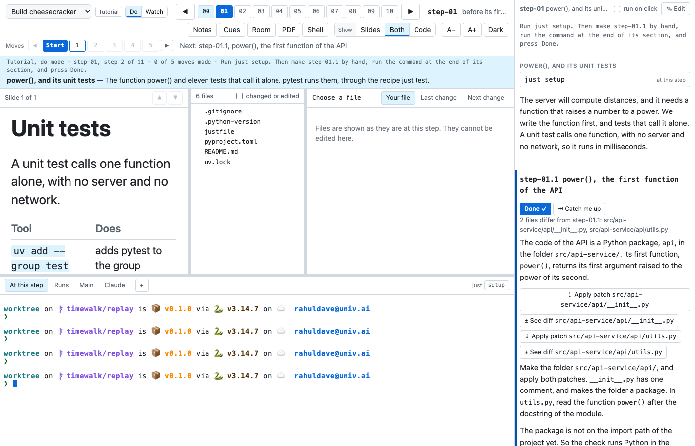
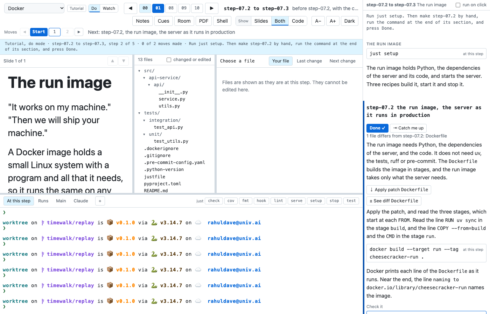

# Make the moves yourself

In do mode, you make each move by hand, and timewalk checks your files against the move's. Choose **Do** with the
switch beside the menu. The walk **Build cheesecracker** has the same notes as the first walk, and starts in do mode.

The move that you work on has these buttons. PATH stands for the path of a file of the move:

| Button | What it does |
|---|---|
| **Done ✓** | Marks the move done, and goes on to the next move. timewalk leaves your files as they are |
| **⇥ Catch me up** | Changes the files of the project to how they are after the move. Your own try at the move is not lost: timewalk keeps it on a git branch named `timewalk/saved/...` |
| **⇣ Apply patch PATH** | Runs a `git apply` command in the terminal. The command makes the move's change to your copy of that file. Once you have changed the file by hand, the button reads **⇄ Replace with the move's file PATH**. It keeps your version on a saved branch, and takes the move's file |
| **± See diff PATH** | Opens the change of that file in the reader |

Under the buttons, a line says how many of your files differ from the move's, and which. Here it says "2 files
differ from step-01.1", before the work starts. When your files match, the line says so, and timewalk marks the move
done for you. The line is a hint, and never stops you.

Make each change as the notes say. Apply a patch, or type the change in your editor. Then run the command under
**Check it**. If the move is not marked done yet, press **Done ✓**.

In the walk Docker, the move step-07.2 writes the `Dockerfile` that builds the run image. Before you start, the
`Dockerfile` is the one file that differs, and its patch is ready to apply:

Next, [Read a walk without timewalk](tour-site.md) shows the pages of the class.
