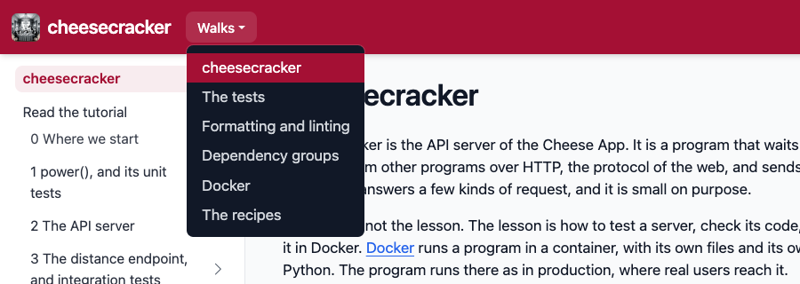
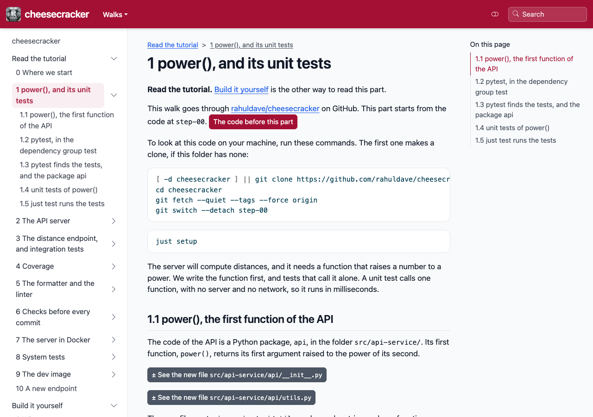
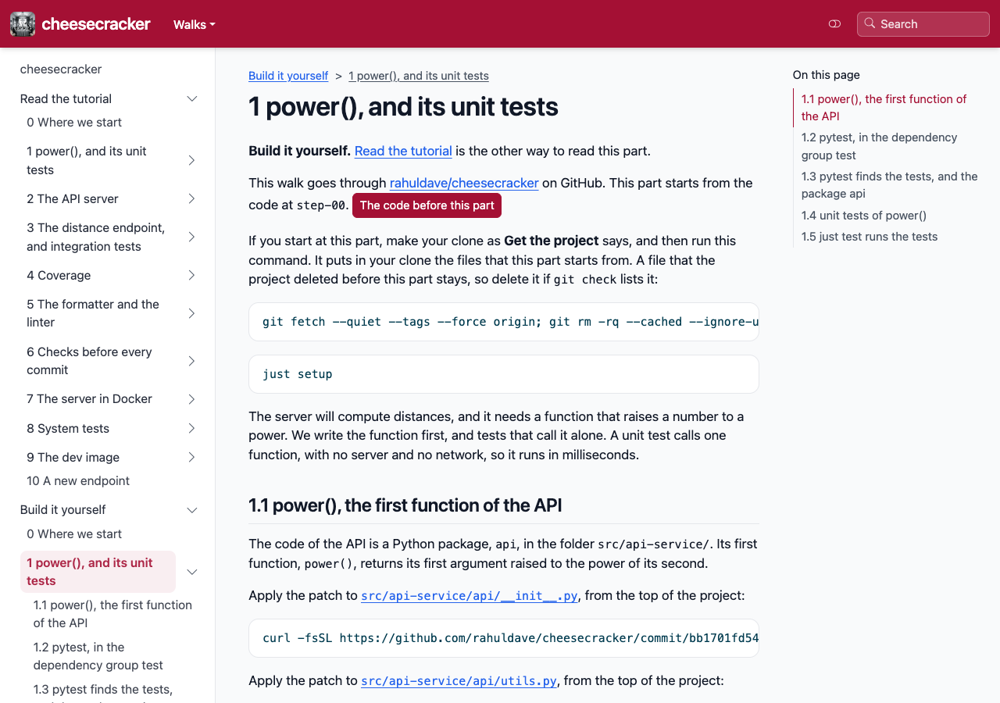

# Read a walk without timewalk

[walk-kit](https://github.com/rahuldave/walk-kit) is the kit that makes a class, with its notes, its walk repository, and
its pages. A class made with walk-kit also has pages that need no timewalk. They are on
GitHub, and on a website. cheesecracker's website is at
[rahuldave.com/cheesecracker-walk](https://rahuldave.com/cheesecracker-walk/).

The menu **Walks** in the header lists the walks that have pages. Build cheesecracker is not in the menu. It has the
same notes as the first walk, and differs from it only in the mode it starts in. So its pages are the Build it
yourself pages of the first walk.

A tutorial has two ways of reading, which the sidebar lists:

- **Read the tutorial** explains each change, with the code to look at. It is watch mode, as a page.
- **Build it yourself** gives every command to run and every patch to apply, in a clone of your own. It is do
  mode, as a page.

Each page holds one part of the walk. A part is a step, or a few moves of a step. Its top names the project on GitHub and the code
that the part starts from, with a button to that code. After each move comes **What changed**, with the diff of every
file that the move changed. Last, the page names the code that the part ends at.

Build it yourself starts with **Get the project**, on the front page of the walk. Its commands clone the project, and
add a git command, `git check`. After each move, the page gives `git check` followed by the id of the move's commit, such as `git check 1a2b3c4d5e6f`. Run it, and it
compares your files with the project's files at that move. It prints nothing when they match. When they do not match, it shows which files differ.
