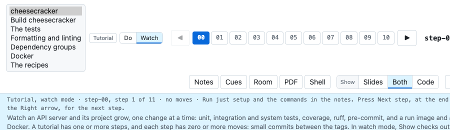
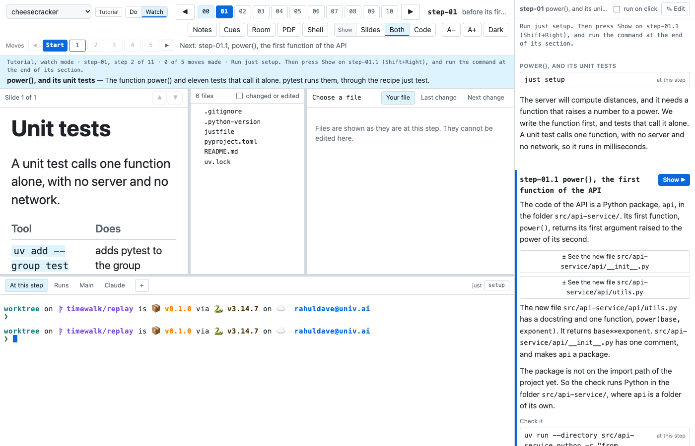
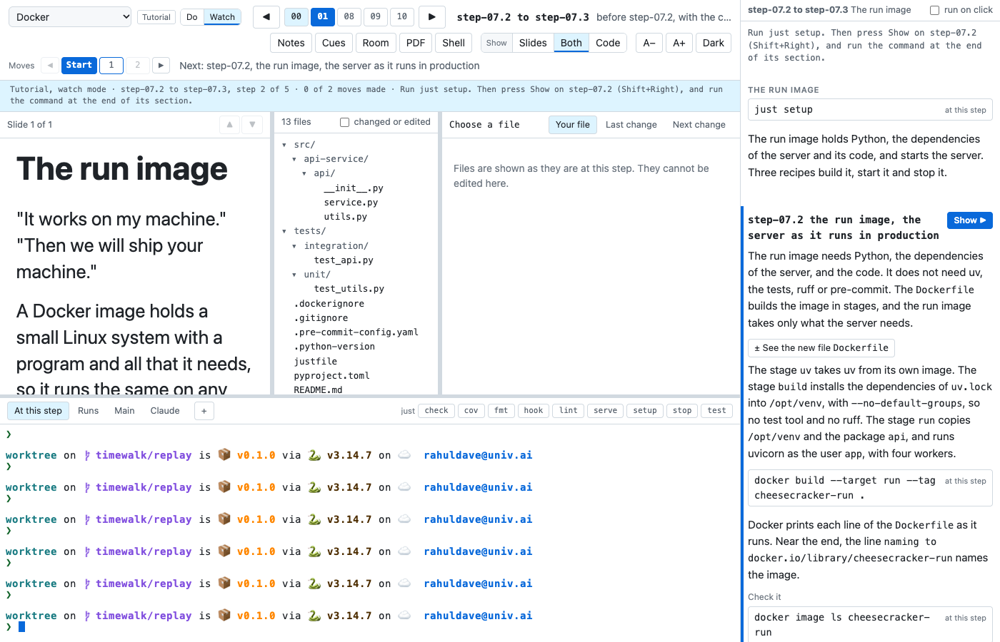

# A class in timewalk

This tour follows one real class, cheesecracker. cheesecracker is a small API server. Its class has seven walks. One
goes through the whole project, and one builds the same project by hand. Each of the others takes one subject, such as
the tests, the formatter and the linter, the groups of dependencies, Docker, or the recipes. The pictures come from the class's walk repository, `cheesecracker-walk`, in a new clone.

## Open the class

A class comes as a walk repository, which holds the notes of each walk, the slides, and a justfile. A justfile is a
list of commands, called recipes, that the program `just` runs by name. Clone it, and run
`just present` in its folder:

```bash
git clone https://github.com/rahuldave/cheesecracker-walk
cd cheesecracker-walk
just present
```

`just present` clones the project into the folder `repo/`, and starts timewalk. Open the address that timewalk
prints. To open a walk other than the first, give its id, for example `just present docker`. The file `toc.toml` of the walk
repository lists the id of each walk. The front page of the class's website gives the command for each.

## Choose a walk

The menu at the top left lists the walks of the class, by their titles. A tutorial has the badge **Tutorial**, and a
switch **Do | Watch** beside the menu. In watch mode, timewalk makes each change for you. In do mode, you make each
change by hand. The menu changes the walk, and the switch changes the mode.



The buttons `00` to `10` are the steps of the walk. A step is one tagged commit of the project. In a tutorial, each
step has moves, the small commits between two tags. The row **Moves** shows them, from **Start** to the last move.

## Watch a step

In watch mode, timewalk makes each change for you. You type only the commands that the notes give. The picture shows step-01 of the first walk, before its
first move. The moves of step-01 are named step-01.1, step-01.2, and so on.



The page has five parts:

- **The band.** The blue band under the row **Moves** says where you are and what to do next. Here it says "Run just setup.
  Then press Show on step-01.1". `just setup` runs a recipe of the project that installs what the step needs. Type it
  in the terminal **At this step**.
- **The slide.** The slide of the step, on the left.
- **The files.** The file list, and the reader beside it. A click on a file shows it as it is at this step.
- **The terminals.** Real shells in the project as it is at this step. The tab **At this step** opens in the
  replay copy. The replay copy is a second copy of the project, in the folder `worktree/`.
  timewalk moves it from step to step.
  `repo/` never moves. The buttons on the right of the tabs run the
  recipes of the project's justfile.
- **The notes.** The notes of the step, on the right. A command in a box types into the terminal when you click it.
  With **run on click**, it also runs.

Each move is a section of the notes. The next move has the button **Show ▶**. A press on **Show ▶** changes the files of the project to
how they are after that move, in every window. Under it, each file of the move is a button, such as **± See the new file src/api-service/api/utils.py**,
which opens the file's diff in the reader. The command under **Check it** shows that the move works.

The walk Docker takes only some moves of the whole project. Each of its steps holds a few moves, for example
step-07.2 to step-07.3. Those two moves build the run image, the Docker image that runs the server:



Next, [Make the moves yourself](tour-do.md) shows do mode.
