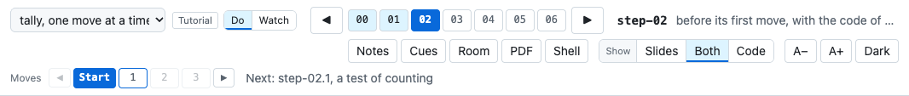
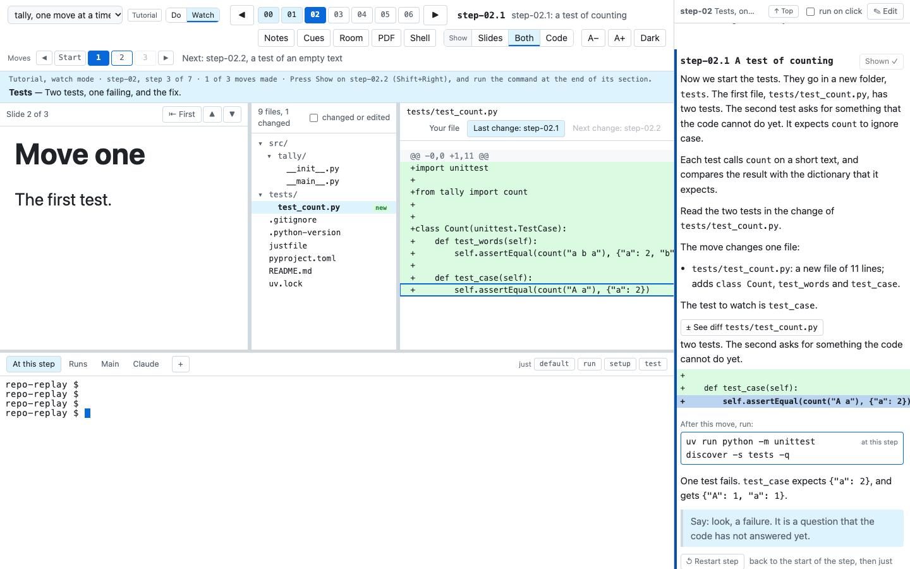
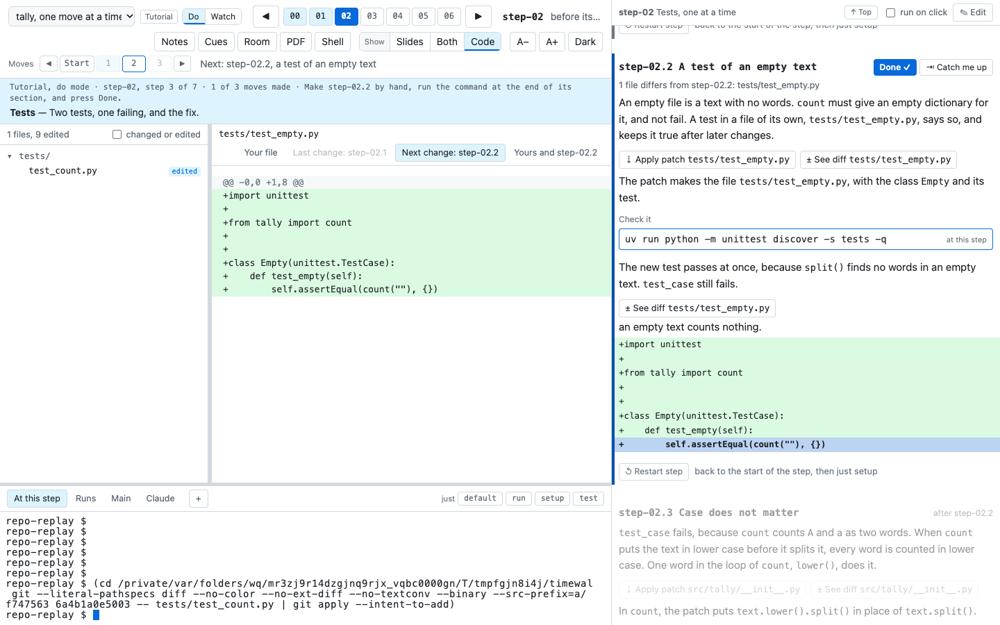

# Several walks

A walk is one path through the history of your repository, with its own notes and slides. One class can
have several walks. For example, one walk tells the whole story of the project, step by step, and a second
walk covers only the tests. A table of contents lists the walks, and a menu at the left of the step bar
changes the walk in every window.

A walk is a narrative or a tutorial. A narrative goes from tag to tag. A tutorial also stops at each small
commit between two tags, and the class makes the step one move at a time.

To build a class with several walks, see [Build a class with several walks](build-walks.md).
[What a narrative and a tutorial need](authoring.md) lists what each kind of walk needs, as checklists.

Try it on the demo. In a clone of timewalk, run `just demo-walks`. The demo has two walks. "The demo, step
by step" has all five steps, and "Only the checks" has two of them. The class timewalk-test has nine
walks, five of them tutorials. Four of its walks are small walks, taken out of its big tutorial.



## The table of contents

The table of contents is a TOML file, `toc.toml`, in the class folder. It holds one `[[walk]]` table for
each walk. The first walk is the default.

```toml
[[walk]]
id = "story"
title = "The project, step by step"
description = "How the project was built, one tagged step at a time."
kind = "narrative"
notes = "notes.md"
slides = "slides/slides.toml"

[[walk]]
id = "tests"
title = "Only the tests"
description = "Three steps of the project: the code, its tests, and a fix."
kind = "narrative"
folder = "walks/tests"            # its notes.md, and slides/slides.toml, are in this folder
steps = ["step-01", "step-02", "step-05"]
```

| Key | Holds |
|---|---|
| `id` | The name of the walk, for `--walk`. Letters, digits, `-` and `_` |
| `title` | What the menu shows. Default: the `id` |
| `description` | Optional. What the walk is about, in a sentence or two. The status band shows it at the first step of the walk. See [The status band](page.md#the-status-band) |
| `kind` | `"narrative"`: the tagged steps, and nothing between them. `"tutorial"`: the tagged steps, and the small commits between them. See [Tutorial walks](#tutorial-walks). Default: `"narrative"` |
| `notes` | The notes file of the walk |
| `shared` | Optional. In a tutorial with notes of its own, the notes of the big tutorial, where its include lines take the sections of its moves. Not with `select`, `steps` or `intro`. See [A walk with notes of its own](#a-walk-with-notes-of-its-own) |
| `slides` | The slides manifest of the walk |
| `folder` | A folder for the walk. Its notes are `notes.md`, and its manifest is `slides/slides.toml`, in this folder |
| `steps` | Optional. Some of the steps, by name. Without it, the walk has every step. A tutorial cannot have `steps`. It takes `select` |
| `select` | Optional. The steps, the moves and the ranges of moves that the walk takes from a bigger walk, in the order of the history, for example `["step-04", "step-05.3..step-05.6"]`. An entry can have a title, for example `{ range = "step-05.3..step-05.6", title = "Types" }`. Give `steps` or `select`, not both. See [Take a small walk out of a big one](#take-a-small-walk-out-of-a-big-one) |
| `intro` | Optional. A Markdown file about the walk. The notes column shows it at the first stop of the walk, under "About this walk". The copies of the walk put it before the first step, in place of the text of the notes before the first step. See [The intro of a walk](#the-intro-of-a-walk) |
| `loose` | Optional. In a tutorial, the files that do mode compares by the names of their packages, for example `["pyproject.toml", "uv.lock"]`. A glob is also good. See [Files that match by the names of their packages](#files-that-match-by-the-names-of-their-packages) |
| `tags` | Optional. A glob for tags of its own, for example `"parts-*"` on another branch. Give `steps` or `tags`, not both |
| `setup` | `"manual"`: you run `just setup` yourself at each step. The only value for now |
| `moves` | In a tutorial, the mode that it starts in. `"do"`: the learner makes each move by hand. `"watch"`: timewalk checks out the commit of each move. See [Do mode and watch mode](#do-mode-and-watch-mode). Default: `"do"` |
| `sync` | In a tutorial, `true` or `false`. With `true`, the slides and the moves follow each other. Default: `true` |

timewalk reads every path from the folder of `toc.toml`. Give a walk `folder`, or give it `notes` and
`slides`. A walk can also have no notes, or no slides. In a folder, `notes.md` and `slides/slides.toml` are
each optional.

## A class folder with several walks

Keep the files of each walk in its own folder. The default walk can stay at the top, as in a class with
one walk:

```
my-class/
  toc.toml
  notes.md                    the default walk
  slides/slides.toml          its slides, and the slide files
  walks/
    tests/
      notes.md
      slides/slides.toml      it can name ../../../slides/talk.md#3
```

A manifest of one walk can use the slide files of another. Write the path from the folder of the
manifest, for example `../../../slides/talk.md#3`. The page serves slides only from the slides folders of
the walks.

Put every slide file there, and every picture that a slide shows. Keep each manifest in a slides
folder of its own, not at the top of the class folder. Keep the notes out of the slides folders. The page
never serves the notes or `toc.toml`, and the checks report a layout that would. See [Slides and documents](slides.md#the-manifest) for the entries.

## Start timewalk with a table of contents

Give `--toc` in place of `--notes` and `--slides`:

```
timewalk ~/code/project --toc my-class/toc.toml
timewalk ~/code/project --toc my-class/toc.toml --walk tests
```

timewalk starts on the first walk, or on the walk that `--walk` names. Each walk names its own tags, so
`--toc` does not go with `--tags` or `--commits`.

## Change the walk

Choose a walk in the menu at the left of the step bar. Every window changes to the steps, the notes and
the slides of that walk.

- **The menu** shows only when the table has two walks or more. If the table has both kinds of walk, the
  menu puts them in two groups, **Narratives** and **Tutorials**. Each group keeps the order of the table.
- **A label** beside the menu says the kind of the walk on show, **Narrative** or **Tutorial**.
- **In a tutorial,** a switch beside the label changes the mode, **Do** or **Watch**.
- **The Room window** has no menu. It shows the title of the walk, with its kind, and for a tutorial its
  mode, for example "(tutorial, watch mode)".
- **The status band** under the step bar names the kind of the walk and the step. At the first step of
  the walk, it also shows the `description` of the walk. A sentence after it says what the kind of walk
  asks of you. See [The status band](page.md#the-status-band).

If the bar has no room for the menu, its buttons move to a second row.

A change of walk moves the replay copy, by the same rules as a move between steps:

- **If the replay copy has edits,** the move keeps them on a saved branch, named after the step on show,
  and does not ask. See [Live edits](edits.md#moving-with-edits).
- **timewalk remembers each walk.** It keeps the step, the move, the slide and the scrolls of each walk.
  When you come back to a walk, the page shows the place where you left it.

**Save** in the notes column writes the notes file of the walk on show. The **PDF** button makes the PDF of
the walk on show.

## The checks

timewalk checks every walk when it starts. An error stops timewalk, and a warning prints and does not.
Run the same checks alone with `timewalk-check`:

```
timewalk-check ~/code/project --toc my-class/toc.toml
timewalk-check ~/code/project --notes notes.md --slides slides/slides.toml
```

The second form checks a class with one walk and no table. `timewalk-check` prints one line for each
problem, and exits with code 1 when it finds an error.

| Problem | Gives |
|---|---|
| A notes section or a slides entry for a step that is not in the walk | An error |
| In a tutorial, a move with no `###` section, a `###` section for no move, or sections out of the order of the commits | An error |
| A `moves` value other than `"do"` or `"watch"`, and other mistakes in `toc.toml` | An error |
| A step with no entry in `slides.toml`. Give each step one slide or more | An error |
| A slide file that does not exist, or that is not in a slides folder of a walk | An error |
| A picture that a Markdown slide shows from outside the slides folders | An error |
| A manifest at the top of the class folder, or notes in a slides folder | An error |
| A slide number past the end of its Markdown file, or a page past the end of its PDF | An error |
| A notes file or a manifest inside your repository or its replay copy | An error |
| A step with no section in the notes | A warning |
| A block `::: do` or `::: watch` that is not closed, a heading in a block, or a block in a block | An error |
| In a tutorial, a move whose section has no command, in one mode or in both. A `do$` line does not count | A warning |
| In a tutorial, a `do$` line in a block `::: do` or `::: watch`, before the first move of a step, or after the commands that check its move. In a narrative, any `do$` line | A warning |
| A fenced div of another name, for example `::: callout-note`, or a line `:::` that closes no block | A warning |
| In a tutorial, a `diff` item for a file that its move does not change, or a `file` item for a file that is not in the commit of its move | A warning |
| In a tutorial, a `show:` line that is no longer in the change of its item | A warning |
| A `show:` line that quotes a line with a backtick in it in one backtick, and not in two | A warning |
| In a tutorial, an item that names a move that is not in the walk | A warning |
| An entry of `loose` that no move of the walk changes | A warning |
| A public cue, for example `> Try:`, in the blockquote of a private cue, for example `> Say:`, in the notes or in the intro file of a walk | An error |
| A slide file in a slides folder that no walk uses | A warning |
| In a walk with notes of its own, a mistake in its stops or its include lines | An error or a warning. See [The checks of a walk with notes of its own](#the-checks-of-a-walk-with-notes-of-its-own) |

A picture that a Markdown slide shows counts as used.

In a tutorial, the checks read the items, the `show:` lines and the anchor commands once for each mode.
Each mode has the text outside the blocks and its own blocks. A warning for one mode names it, for
example "step-02.1 has no command in watch mode". See
[Blocks for one mode](#do-mode-and-watch-mode).

## Tutorial walks

A tutorial walk stops at every small commit between two steps. Each small commit is a move. A tutorial
has one or more steps, and each step has zero or more moves. The class makes the moves of a step one at a
time, and reads the notes of each move.

The moves of a step are the commits after the step before it, up to the commit of the step, on the
first-parent line. The first-parent line is the line of commits that git follows back from a commit
through the first parent of each merge. The last move is the commit of the step, with its tag. A step of
one commit has no moves, and the first step has none.

timewalk names a move by its place, so its subject can say anything, or nothing. `jj new` makes a move with
no subject. A subject such as `step-02.1: a test of counting` helps you read `git log`. The title of the move
comes from its `###` heading in the notes, or else from its subject.

```
step-01: count the words              tag step-01
step-02.1: a test of counting         move step-02.1
step-02.2: a test of an empty text    move step-02.2
step-02: the tests pass               tag step-02, move step-02.3
```

A tutorial takes every tag of its glob, so it cannot have `steps`. For a tutorial on one part of the
history, name its steps and moves with `select`. See
[Take a small walk out of a big one](#take-a-small-walk-out-of-a-big-one).

### The notes of a tutorial

Give each move a `### step-NN.k Title` section, in the order of the commits. Here `NN` is the number of
the step and `k` is the number of the move. A move section holds these parts:

- **The problem, and the change that solves it,** for both modes. See
  [Write for a reader who has never heard of timewalk](authoring.md#write-for-a-reader-who-has-never-heard-of-timewalk).
- **The change, piece by piece.** Each file of the move comes from one line. A `do$` line gives a command
  that writes it, for example `do$ uv add --group test pytest`. A `patch$` line names a file that the move
  changes by a patch, for example `patch$ scripts/corpus.py`. See
  [patch$ lines](authoring.md#patch-lines) and [Write for both modes](authoring.md#write-for-both-modes).
- **One or more commands that check the change,** with the result to expect. They are the anchor of the
  move.
- **Last, a line `files:`, with items.** Each item is one file of the commit, with words that say what to
  look for. A `show:` line under an item quotes the main line of the change. See
  [The items under files](#the-items-under-files).

````markdown
## step-02 Tests, one at a time

$ just setup

We cannot tell whether `count` still works after a change, so we write tests. We add them one file at a
time, and run them after each.

### step-02.1 A test of counting

The first test says what `count` gives for a short text. The second test also asks that "A" and "a"
count as one word, which `count` does not do yet.

::: do
Make the file `tests/test_count.py`, with these lines:

```python
import unittest

from tally import count


class Count(unittest.TestCase):
    def test_words(self):
        self.assertEqual(count("a b a"), {"a": 2, "b": 1})

    def test_case(self):
        self.assertEqual(count("A a"), {"a": 2})
```
:::

::: watch
The new file `tests/test_count.py` holds two tests. `test_case` gives `count` the text `"A a"`, and
expects `{"a": 2}`.
:::

$ uv run python -m unittest discover -s tests -q

One test fails. `test_case` expects `{"a": 2}`, and `count` still tells "A" from "a".

files:
- diff `tests/test_count.py`: two tests. The second asks for something the code cannot do yet.
  show: `self.assertEqual(count("A a"), {"a": 2})`
````

### Anchor commands

The last commands of a move section are its anchor commands. An anchor command shows what the move did,
for example a test run or a run of the program. The notes column shows them under the label "Check it".

A run of commands ends where the mode changes. So the last command of a `do` block and a shared command
after it are two runs. Only the last run of shared commands in a move is its anchor. A move with all its
commands in blocks has no anchor. See
[Blocks for one mode](#do-mode-and-watch-mode).

A `do$` line is a run of its own. It changes files that git tracks, so it is never an anchor command. A
move whose only commands are `do$` lines has no anchor.

- **Make each anchor command safe to run again.** It must not change files that git tracks.
- **Say what the command gives.** A test that fails is a good anchor, if the notes say that it fails and
  why.

`timewalk-check` warns of a move whose section has no command.

### Do mode and watch mode

A tutorial has two modes. Every window shares the mode. The switch **Do** or **Watch** beside the label
of the walk changes it, at any step and at any time. The key `moves` in `toc.toml` sets the mode that the
tutorial starts in.

- **Do mode** is the default. The learner makes each move by hand from its notes. The code does not move
  until the learner asks.
- **Watch mode** checks out the commit of each move when you ask. The learner reads the change, and runs
  the anchor commands.

A move to a tagged step always starts that step at the tag before it, with no move made. So in both modes,
each step starts from the code of the step before.


In do mode, each move section has these buttons:

| Button | Does |
|---|---|
| **Done ✓** | On the move that the learner works on: marks it done, and goes on to the next move. The code does not move |
| **⇥ Catch me up** | On the move that the learner works on: checks out the commit at the end of that move, in every window. If the replay copy has edits, the move keeps the work of the learner on a saved branch first. It never discards them |
| **Made ✓** | On a move already made, in place of **Done ✓**. It is grey, and does nothing |

The moves go in order, in both modes. A step starts with `just setup`, so any step is a safe place to
start. A move has no setup of its own, so it builds on what the moves before it did to the environment. A
skip would miss that. So the moves after the next one are grey, and their buttons, commands and items do
nothing. The way back is the step's **Start**, or **↺ Restart step** in the notes, and then `just setup`.

An item under `files:` opens the change of its move in the reader, even before the file exists. In do
mode, the reader then shows the change in the tab **Next change**. A `patch$` line of the move gives a
button that applies the patch. See [The reader in a tutorial](#the-reader-in-a-tutorial) and
[patch$ buttons](#patch-buttons).



In watch mode, the next move has a **Show ▶** button. It checks out the commit of that move, in every
window. If the replay copy has edits, the move keeps them on a saved branch first. A move already shown
has a grey **Shown ✓** button in its place, which does nothing.

#### Blocks for one mode

The two modes need some different words. In do mode, the notes must give every line to type. In watch
mode, the code is already there. The notes say what the change does and where to see it, and the lines
to type get in the way. But the problem, the explanation, the check and the items are the same in both
modes.

So the notes of a tutorial can hold a block for one mode, for only the words that differ. A block is a
fenced div, as Pandoc, Quarto and smalldocs read it. A line `::: do` or `::: watch` opens it, and a line
`:::` closes it.

````markdown
### step-02.1 A test of counting

`count` must give the number of each word, and count "A" and "a" as one word. Two tests say so. The
second asks for something that the code cannot do yet.

::: do
Make the file `tests/test_count.py`, with these lines:

```python
import unittest

from tally import count


class Count(unittest.TestCase):
    def test_words(self):
        self.assertEqual(count("a b a"), {"a": 2, "b": 1})

    def test_case(self):
        self.assertEqual(count("A a"), {"a": 2})
```
:::

::: watch
The new file `tests/test_count.py` holds two tests. `test_case` expects `count("A a")` to give
`{"a": 2}`.
:::

$ uv run python -m unittest discover -s tests -q

files:
- diff `tests/test_count.py`: two tests. The second fails.
````

`::: {.do}` also opens a block, and so does a fence of more colons, for example `::::: watch`. The page
shows the notes in this way:

- **The text outside a block** shows in both modes.
- **A `do` block** shows only in do mode, and **a `watch` block** only in watch mode.
- **A `do$` line** shows in both modes. In do mode, it is a command to run. In watch mode, it shows as
  "The move ran:" and the command, with no button. In a strict walk, do mode replaces some `do$` lines of `uv`
  with a command that takes their files. See [A strict walk](#a-strict-walk).
- **The switch Do / Watch** changes the blocks on show, in every window. The step and the move stay.
- **A narrative** has no mode. It shows the `watch` blocks, and `timewalk-check` warns of a `do` block.

A move section can hold several blocks, with shared text between them. For what goes in a block, what
goes in the shared text, and how large to make a block, see
[Write for both modes](authoring.md#write-for-both-modes).

A block has these rules:

- **Close each block with a line `:::`.**
- **Put no `##` or `###` heading in a block, and no other block.** A heading closes a block that is still
  open, and `timewalk-check` reports an error.
- **A fenced code block in a block can hold a line `:::`.** The line is code, and closes nothing.
- **A `files:` line, its items and the `$` commands in a block count only in the mode of the block.** The
  checks read each mode as its reader sees it. See [The checks](#the-checks). The items of one `files:` line
  can go on into a block. Each item in the block is then for its mode only.
- **Cues work in a block.** The copies of `timewalk-export` leave out a private cue in a block too.
- **Put a `do$` line outside the blocks.** In a block, it shows in one mode only. `timewalk-check` warns of
  it, for example `walk tut: notes.md: step-06.1: the do$ line 'uv add --dev ruff' is in the block ::: do`.
  It also warns of a `do$` line before the first move of a step, and of one after the commands that check
  its move. A `do$` line makes a move, so it goes in that move's section, before the checks.

A fenced div of another name, for example `::: callout-note`, is not a block for one mode. Both modes show
it as it is written, and `timewalk-check` warns of it. Such a div can go inside a block. Its closing `:::`
then closes the div, and the block goes on.

The PDF with `--with-notes` has no mode. It prints both blocks, each under a line "In do mode:" or "In
watch mode:". `timewalk-export` writes one copy for each mode, with only the blocks of that mode. See
[Copies of a tutorial for GitHub and a website](#copies-of-a-tutorial-for-github-and-a-website).

### Moves on the page

When a step has moves, a row of moves shows under the step bar, in every window. It has the arrows ◀ and
▶, and a button for each place. The buttons are **Start**, then **1**, **2** and so on. **Start** is the place before the
first move. Beside the buttons, the row shows the move on show and its subject.

| Control | In do mode | In watch mode |
|---|---|---|
| **▶**, or Shift+Right | Marks the move done, and goes to the next | Checks out the commit of the next move |
| **◀**, or Shift+Left, or **Start** | Checks out the tag before the step, and marks no move done. Edits go on a saved branch first | Checks out the tag before the step |
| The number of the next move | The same as **▶** | The same as **▶** |
| Other numbers | Do nothing: the moves go in order | Do nothing: the moves go in order |

After **Start**, run `just setup`, as the first line of the notes says.

- **In a terminal,** use Alt with Shift+Right and Shift+Left.
- **Right and Left** go to the next or the previous step, as in a narrative.
- **The status band** gives the mode, the step and the count of moves made. It then says what to do now,
  for example "press Show on step-02.1". The first line of the notes says the same thing.
- **The notes** scroll to the section of the move on show, in every window. At **Start**, they go to the
  top, where `just setup` is.
- **Last change** and **Next change** in the reader follow the moves. See
  [The reader in a tutorial](#the-reader-in-a-tutorial).

In the notes, the sections of the moves have no boxes. Each section runs from edge to edge of the column,
with a bar on its left:

| Section | Looks |
|---|---|
| The text before the first move | A section of its own, under the title of the step and with no bar. The text is about the whole step |
| A move made | A grey bar, and a check before its name |
| The move on show | A dark bar |
| The next move | A blue bar |
| A move after the next | Faded, with no bar |

Once a move is made, each section of a move made ends with **↺ Restart step**, and so does the section of
the move on show. The button goes back to the step's **Start**, in every window, as **Start** does. The
code goes back to the step before. If the replay copy has edits, the move keeps them on a saved branch
first. Then run `just setup` again.

When every move of the step is made, a green **Next step** button ends the notes, with the name of the
next step. The same button shows in the head of the slides, at the last slide. The Room window does not
show the button on the slides.


timewalk writes down the move on show in the git folder of the replay copy. After a restart, the page
comes back at the same move, and the moves before it count as done. [What timewalk does with git](git.md#what-is-checked-out-and-when) says what
each mode checks out, and when.

### The items under files

A line `files:` in a move section starts a list of items. An item is one file to look at, with words
that say why. You write the words by hand, but the change that an item opens comes from the commits,
each time the page draws it. So the notes hold no copy of a diff.

```markdown
files:
- diff `src/tally/__init__.py`: one word, `lower()`, answers the failing test.
  show: `for word in text.lower().split():`
- file `tests/test_count.py`: read `test_case` again. It passes now.
```

| Line | Does |
|---|---|
| ``- diff `path`: words`` | A button **± See diff path** that opens the change of the move to that file, and its words |
| ``- file `path`: words`` | A button **▤ See file path** that opens the file itself, and its words |
| ``- diff step-02.1 `path`: words`` | The same for another move, named before the path |
| ``  show: `a line` `` | Under an item: a line of the change, quoted. The notes draw it as an excerpt, and the reader marks it |
| ```  show: ``a `b` c`` ``` | The same, for a line with a backtick in it. See [Quote a line with backticks](#quote-a-line-with-backticks) |
| An indented line under an item | More of the words of the item |

On the page, each item is one button with an icon, a verb and the path. The button is **± See diff** for
a `diff` item, and **▤ See file** for a `file` item. The words of the item go on the line under the button. A
**± See diff** button opens the tab of the reader that holds the change:

- **Next change** for the move that the learner works on.
- **Last change** for the last move made.
- **Changes in step-02.1** for any other move.

A **▤ See file** button opens **Your file**. In do mode, the button of a move that is not made yet opens
**At step-02.3** instead. The view shows the file as the move leaves it, read only.

A `show:` line names one line of the change by its text. Under a `diff` item, the notes draw an excerpt
of the real diff there. An excerpt is a small part of the diff, read only. It holds the line and two
lines of context on each side, or the whole hunk when the hunk is about eight lines or fewer. A hunk is
one run of changed lines in a diff. When the item opens the reader, the reader marks the same line.

The excerpt is a band across the whole column, and the page shades the named line. A click on the excerpt opens
the change, as the button of its item does. In a move after the next one, the click does nothing.


If a `show:` line is no longer in the change, the notes draw a red band that says so. A click on the band
opens the change too. A fix to the history can remove a quoted line. `timewalk-check` warns of it too.

### Quote a line with backticks

A backtick is the character `` ` ``. The quoted line of a `show:` line is a code span, as in CommonMark. A
code span is code in a line of text, between backticks. Write a line in one backtick. If the line has a
backtick in it, write it in two backticks:

```markdown
  show: `x = 1`
  show: ``The command `wikiapp` uses this library.``
  show: `` `x` ``
```

The second line quotes ``The command `wikiapp` uses this library.``, with no backticks around it. timewalk
drops one space inside each end, as CommonMark does. So the third line quotes `` `x` ``. Write a line that
starts or ends with a backtick in this way, with a space inside each end.

A line with a backtick in it, in one backtick, shows wrong on GitHub and in the copies. They end the quote
at the first backtick in it. The page still finds the line, if the line does not end with a backtick. If
the line ends with a backtick, timewalk does not read it as a `show:` line. In both cases, `timewalk-check`
warns of it, with the line number, and says how to write it. The page draws the excerpt from the real
line of the change, so the page shows a `show:` line that it reads right.

A line `files:` with no items under it shows a **± See diff** button for each file that the commit of
the move added or changed. Items also work in a narrative. There, a `diff` item opens **Last change**, the change of the
step. The PDF prints each item line as it is written.

### The reader in a tutorial

In a tutorial, the reader has up to five views. Two views read the disk, and two compare commits. The
label of each change names its move.

| View | Shows |
|---|---|
| **Your file** | The file in the replay copy, as the learner left it |
| **At step-02.3** | The file as a move leaves it, read only. It shows only when a `file` item of a move that the learner has not made opens it, in do mode |
| **Last change: step-02.2** | The move before, to this one: the change of the move just made |
| **Next change: step-02.3** | This move, to the next one: the change of the move to make now. It is empty at the last move of a step |
| **Yours and step-02.3** | In do mode: your file against the file as the move to make now leaves it. Lines with `-` are yours, and lines with `+` are the move's |
| **Your edits** | The edits since the commit that the replay copy stands on |

In do mode, the code does not move, so **Last change** and **Next change** follow the moves marked
done. In watch mode, they follow the move on show. At **Start**, no move is made, so **Last change** is
empty and **Next change** is the first move.

In a narrative, **Last change** compares the step before with this step. **Next change** compares this
step with the next step, before you move to it.

**Next change** is what the commit of the move changed. **Yours and step-02.3** is what is left to do. It
compares your file with the file as the move leaves it, as the match does. So the learner
sees both what they did and what the move expects.

Before any edit, the two tabs show the same change. When
your file matches the move, the tab is empty. A file of the walk's `loose` that matches by the names of its
packages says so above its diff, as the versions can differ.

### patch$ buttons

A line `patch$ PATH` in the notes says that the move changes `PATH` by a patch. See
[patch$ lines](authoring.md#patch-lines). In do mode, on the move that the learner works on, the line shows
a button that fits the learner's file. The button types a git command into the **At this step** tab, and
runs it. The learner sees exactly what ran.

| Button | Shows when | Types into the shell |
|---|---|---|
| **⇣ Apply patch PATH** | The file is as it was before the move | ``(cd COPY && git --literal-pathspecs diff --no-color --no-ext-diff --no-textconv --binary --src-prefix=a/ --dst-prefix=b/ A B -- PATH \| git apply --intent-to-add)`` |
| **⇄ Replace with the move's file PATH** | The learner has changed the file | ``(cd COPY && git --literal-pathspecs checkout B -- PATH && git --literal-pathspecs reset -q -- PATH && git --literal-pathspecs add -N -- PATH)`` |

Here `COPY` is the replay copy's own path, `A` is the commit before the move, and `B` is the commit of the move. The
command names the copy by its path, so a shell that went elsewhere changes nothing there. The options of `git diff`
give the form that `git apply` reads, whatever your git config says. A path is a name, not a pattern.

- **Apply patch is a plain `git apply`.** It merges nothing and stages nothing. So a file never gets
  conflict markers. The change becomes an edit, and HEAD stays where it is. A new file is tracked with
  nothing staged, so **↺ Restart step** keeps it on a saved branch, as any edit.
- **Replace keeps the learner's version first.** The server puts it on a branch
  `timewalk/saved/<move>-yours`, a commit on top of HEAD. It writes no file. For a file that the move
  deletes, Replace types `rm -f -- PATH`. What the learner staged with `git add` is kept too, in a commit of its
  own. A copy with `--in-place`, or a replay worktree of an older version, shares its branches with your
  repository. It cannot keep a branch, so Replace is off there.
- **A renamed file needs a `patch$` line for each of its two paths.** Then the old file goes too. `timewalk-check` warns of a rename with one.
- **The button is off** when the file is already as the move leaves it.
- **The buttons follow the learner's file.** They change after each edit, and on each check of the match.
- **± See diff PATH** opens the reader on the move's change of that file.
- **The page itself never writes a file.** The shell runs the command, as any terminal does.
- **The Room window shows no Apply patch or Replace button,** only **± See diff PATH**.

The learner can also make the change by hand. The tab **Yours and step-NN.k** shows what still differs.
Either way, the move is marked done when the files match. In watch mode, the line is one button that opens
the diff. A new file reads **± See the new file PATH**, and a changed one **± See the change to PATH**.



### Your files match

In do mode, the page asks timewalk every two seconds if the learner's files match the commit of the move
that the learner works on. The answer shows on the section of that move:

- **"Your files match step-02.3 ✓"** when every file is the same as in the commit.
- **"2 files differ from step-02.3: a.py, b.py"** with the names of the files that differ.

A match marks the move done by itself, once for each move. Only your own window marks the move, and never
the Room window.

The comparison is by content, and by whether each file can run. So a move of `do$ chmod +x x` alone is
made only by `chmod`.

The comparison takes every file that differs between HEAD and the commit of the
move, and every file with edits. A new file of the move counts, even when git does not track it yet. The
comparison is strict, so one extra space is a difference. It is a hint and never a gate. **Done ✓**
still marks a move done when the learner made it another way.

### Files that match by the names of their packages

A move made with `uv add`, for example `uv add --group test pytest`, writes the newest version of the
package into `pyproject.toml` and `uv.lock`. A learner who makes the move on a later day can get a newer
version. The strict comparison then never matches. The key `loose` of the walk names the files to compare
by the names of their packages:

```toml
[[walk]]
id = "tutorial"
kind = "tutorial"
loose = ["pyproject.toml", "uv.lock"]
```

Each entry is a path in the project, or a glob, for example `"*.toml"`. In a glob, `*` also matches a `/`.
timewalk compares a file that `loose` names in this way:

- **A `pyproject.toml`** matches if it says the same, with the versions taken out of each requirement.
  The name of the package, its extras, its address (`@ git+https://...`) and its marker (`; sys_platform != 'win32'`)
  still count. A requirement is a line such as `"pytest>=8.3"` in `project.dependencies`,
  `project.optional-dependencies`, `dependency-groups`, `build-system.requires` or
  `tool.uv.dev-dependencies`. The order of the requirements does not count. The names are compared as PyPI
  compares them, so `Foo_Bar` is `foo-bar`. Every other setting, for example `requires-python`, must be the same.
- **A `uv.lock`** matches if the packages of the project ask for the same packages by name. Its
  workspace must have the same members, and `requires-python` must be the same. The packages of the project are the ones whose source is the project
  itself, `editable` or `virtual`. The versions, and the packages that those packages need in turn, are
  not compared. A `uv.lock` does not say in which group each package is, so name `pyproject.toml` in `loose`
  too, as the example does.
- **Any other file** that `loose` names is not compared by its contents. But if the move makes the file,
  the learner must make it too. If the move deletes it, the learner must delete it.

A `pyproject.toml` or a `uv.lock` that the move makes must be there too, as any file must.

A file that matches only by the names of its packages is still a match, and the move is marked done. The
page names such files after the tick, for example "Your files match step-02.1 ✓ (pyproject.toml, uv.lock
by the names of the packages, not their versions)". A file left out shows as "(notes.txt not compared)".
**Apply patch** and **Replace** still write the file of the commit, with its versions.

`loose` is for a tutorial only. `timewalk-check` gives an error for `loose` in a narrative, or for a
`loose` that is not a list of text. It warns of each entry that no move of the walk changes, for example
`walk tut: loose names nothing/*.toml, which no move of the walk changes`.

It also warns of a move whose changes are all in files that `loose` names, and that a loose match finds
equal. An example is a move that only changes the version of a package. Do mode would mark that move done
before the learner makes it. Take its files out of `loose`, or join the move with one that changes more.

### A strict walk

A tutorial whose `loose` does not name `pyproject.toml` or `uv.lock` is strict for that file. Do mode
compares the file line by line, so the learner must have the author's versions.

**Problem.** The author's move runs `do$ uv add --dev ruff`, and that command wrote ruff 0.17.0. A learner
runs the same command a month later, and gets ruff 0.17.1. The learner's `uv.lock` then differs from the
move's `uv.lock`, and **Your files match** never comes.

**Fix.** In do mode of a strict walk, the page does not give such a `uv` command. It says that the author
ran the command, and gives one command in its place, for example:

```bash
git restore --source 1a2b3c4d5e6f -- pyproject.toml uv.lock && uv sync --locked --all-groups --all-packages
```

- `git restore --source 1a2b3c4d5e6f` takes each file that the `uv` command wrote from the commit of the
  move, as the author has it. A `uv` command such as `uv init` writes other files too, for example
  `.python-version`. The command takes them too.
- `rm -f` follows for each file that the `uv` command deleted, if there is one.
- `uv sync --locked --all-groups --all-packages` installs exactly the versions of that `uv.lock`, in every
  group and every member of a workspace. It does not change `uv.lock`. It comes once for each `uv.lock`
  that the command takes. For a `uv.lock` in a folder, for example `sub/uv.lock`, it has `--directory sub`.

The command is from the top of the project. A click on it types it into the **At this step** tab. With
run on click, it also runs. The move then matches. Watch mode, and a walk whose `loose` names both files,
still show the `uv` command.

The page does this for a `do$` line when two things are true:

- The line runs `uv`. Its first word is `uv`, or the first word after `&&`, `||`, `;`, `|` or a bracket is
  `uv`, for example `cd sub && uv add x`. Settings before the word are skipped, so `UV_INDEX=x uv add y` runs
  `uv` too.
- The line writes a file of the move, a `pyproject.toml` or a `uv.lock` that `loose` does not name.

**`uv` behind another command is an error.** In `env A=1 uv add x`, `time uv add x`, `sudo uv add x`,
`bash -c "uv add x"` or `~/.local/bin/uv add x`, the first word is not `uv`. The page then does not find
the `uv` command. It shows the line as the author wrote it, and not the `git restore` command. The learner
runs the line, and can get newer versions than the author's.

So in a move that changes a `pyproject.toml` or a `uv.lock` that `loose` does not name, `timewalk-check`
gives an error for such a line. Put `uv` at the start of the command, for example `A=1 uv add x`.

`timewalk-check` counts each `uv` in the line that starts a word, or comes after `/`, `=`, `(`, `` ` ``,
`:` or `-`, and that ends the word, or comes before `` ` ``, `)` or `}`. It also counts the commands of the line
that start with `uv`. If it finds more of the first than of the second, it gives the error. So `echo uv` and
`cd uv && uv add x` are errors too. For a folder `uv`, write `cd uv/`.

`timewalk-check` cannot see a `uv` that a recipe or a script runs, for example `just lock` or
`./scripts/add.sh`. In a strict walk, write the `uv` command itself on the `do$` line.

A step with no moves, after the first step, is one commit after the step before it. Do mode treats it as one
move, and its `do$` lines of `uv` get the same command. Each of its files comes from a `do$` line or from a
`patch$` line.

**A `uv` command that runs a program stays.** Six commands of `uv` exist to write the files of the project,
for example `pyproject.toml` and `uv.lock`, and run no program of the project. They are `uv add`,
`uv remove`, `uv lock`, `uv init`, `uv version` and `uv sync`. The page leaves out a line of these
commands, and gives the `git restore` command in its place. Every other command of `uv` runs a program or reads the project,
for example `uv run`, `uv tool`, `uv format`, `uv tree` or `uv export`.

- **Problem.** The author's move runs `do$ uv run python make.py`. The program makes `data.csv`, and `uv`
  also locks the project again and writes `uv.lock`. If the page left the line out, the learner would never
  make `data.csv`.
- **Fix.** The page gives the line as a command to run. Then it gives the command that takes the files,
  after the line. A line with both kinds, for example `uv add x && uv run y`, also runs, and the command
  comes after it.
- **A later line.** A later `uv add` that writes the same files gets no command of its own, as the next
  paragraph explains. A later `uv run` that writes `uv.lock` again stays, and the command comes again after it.

A later `do$` line of the move that writes a file of such a line joins it. For example, `do$ uv add click`
writes `pyproject.toml` and `uv.lock`, and then `do$ printf ... >> pyproject.toml` changes `pyproject.toml`.
The commit has each file only as the move ends. So the page gives one command, at the first line, that takes
every file of both lines. At the later line, it says that the command above takes its files.

To know which files each `do$` line writes, timewalk runs the move's `do$` lines in a scratch clone, as
`timewalk-check` does. See [timewalk-check](reference.md#timewalk-check). It runs them in this way:

- **When.** A window opens. timewalk then runs them in the background, the moves of the step on show first.
- **Which moves.** Each move of the walk with a `do$` line of `uv` and a file that is compared line by line.
  It runs every `do$` line of such a move, for example a `do$ just train` too. Until the run ends, no
  `do$` line of the move has a button.
- **Until the run ends.** The page says that timewalk is running the lines, and gives no command to run.
- **The cache.** A move that `timewalk-check` checked before reads the result from the cache, and runs
  nothing. A run where a line fails is not kept.
- **A run that fails.** For example, `uv add` has no network. The first `do$` line of `uv` of the move
  then says that timewalk cannot find the author's versions, and why. It gives the line as it is, and a
  **↻ Try again** button. Try again runs the lines again, for every window. timewalk also runs them again by
  itself when a window loads the notes a minute or more after the failure. A window loads the notes when it
  moves to another step, and when you reload it.
- **The end.** When you stop timewalk, a run in progress stops too.

With `--no-run`, or `TIMEWALK_NO_RUN=1`, timewalk runs nothing, and the page gives the `uv` command.

`timewalk-export --json` gives each such `do$` line the same command, in the field `take`. See
[The facts file](reference.md#the-facts-file). If the lines fail, `timewalk-check` gives an error, with the line that failed and the reason, and the facts file has it in its `errors`. The do copies of
`timewalk-export --markdown` and `--site` give the same command and the same words. If the lines do not run,
the copy gives the `uv` command, and `timewalk-export` says why.

### Slides for moves

A move can have slides of its own in `slides.toml`. Quote its name, because it holds a dot:

```toml
[slides]
step-02 = ["talk.md#3"]
"step-02.1" = ["moves.md#1"]
"step-02.3" = ["moves.md#2"]
```

The slides of a step are its own slides, then the slides of each move, in order. With `sync`, the slides
follow the moves:

- **A move shows its first slide.** A move without slides keeps the slide before it.
- **In do mode,** **Done ✓** shows the first slide of the next move, if that move has slides.
- **In watch mode,** a slide of another move also checks out that move. A slide of the next move makes
  that move, and a slide of an earlier move goes back to it. A slide that is further ahead makes only the
  next move.

Write `sync = false` at the top of `slides.toml`, before `[slides]`, to keep the slides and the moves
apart. The key `sync` in `toc.toml` does the same for the walk, and the manifest wins.

### Draft the notes of the moves

`timewalk-notes` writes a first draft of the section of each move that the notes do not have yet:

```
timewalk-notes ~/code/project --toc my-class/toc.toml --walk tutorial
timewalk-notes ~/code/project --toc my-class/toc.toml --walk tutorial --write
```

Without `--write`, it prints only the drafts. With `--write`, it writes them into the
notes file of the walk. It refuses a notes file inside the project or a replay copy of it. A section that is already in the notes stays as it is. Each draft has its
parts in the order that a reader needs them:

- **A heading** `### step-NN.k`, with the subject of the commit after its name as the title. A step that
  has no section yet gets one too, `## step-NN Title`, with the first line of its tag's message, steps
  without moves too. A walk whose folder has no `notes.md` yet gets one.
- **A comment for both modes.** It asks for the problem that the change solves, and the change.
- **A line `patch$ PATH` for each file of the commit.** Put a `do$` line, the command, in place of the
  `patch$` lines of the files that a command writes.
- **A block `::: do`,** with a comment that asks what to read in each patch, and where in the file. It
  asks for no code, as the patch comes from the project.
- **A block `::: watch`,** with a comment that asks what the change does, and where to see it.
- **A comment that asks for the check,** a command and what it prints. Replace it with the anchor
  commands.
- **Last, a line `files:`, with items.** It drafts an item for every file of the commit, `uv.lock` too. A
  new file gets a `file` item, and every other file a `diff` item. You write the words of each item. It
  writes no `show:` lines.

```markdown
### step-03.1 ruff, a tool for development

<!-- For both modes: the problem this change solves, and the change. ... -->

patch$ pyproject.toml
patch$ uv.lock

::: do
<!-- What to read in each patch, and where in the file. Copy no code: the patch comes from the project. -->
:::

::: watch
<!-- What the change does, and where to see it. ... -->
:::

<!-- A command that checks the result, and what it prints, for example: $ just test -->

files:
- diff `pyproject.toml`: 
- diff `uv.lock`: 
```

The draft has no list of the files in prose. A page made from the facts of the walk makes that list
from the facts. See [The facts file](reference.md#the-facts-file). Finish each draft by hand. Replace each
comment, write the words of each item, and quote the main line of each change with `show:`. Leave out a
block that has nothing to say.

`--blocks` is still accepted, for old scripts, and does nothing. Every draft has both blocks.

See [Write for both modes](authoring.md#write-for-both-modes).

## Copies of a tutorial for GitHub and a website

`timewalk-export` writes copies of a tutorial walk that a reader can read without timewalk. It writes
a Markdown file for each mode, for GitHub. It also writes a website, with a page for each step in each
mode. For a narrative, it writes one Markdown file and one website. See
[The copies of a small walk](#the-copies-of-a-small-walk).

```
timewalk-export ~/code/project --toc my-class/toc.toml --walk tutorial --markdown out
timewalk-export ~/code/project --toc my-class/toc.toml --walk tutorial --site site
smalldocs render site
```

The links go to the project on GitHub. The address comes from the remote `origin` of the project, or from
`--github`. [Reference](reference.md#timewalk-export) lists every option.

### The facts of a walk, for pages of your own

The Markdown and the website of `timewalk-export` stay, for whoever uses them. A class can also make
pages of its own. Then it asks `timewalk-export` for the facts of the walk, in place of a copy:

```
timewalk-export ~/code/project --toc my-class/toc.toml --walk tutorial --json facts.json
```

The facts file is one JSON file. It holds the walk, its stops, and the text of each move in parts for
each mode. It also holds every file that each commit changes, with its whole diff. It has no words or
layout of timewalk, so a class sets its own.

The facts leave out the private lines, as the copies do. `--private` keeps them, for a copy for the
presenter. See [The facts file](reference.md#the-facts-file).

The `walk` skill of walk-kit, at github.com/rahuldave/walk-kit, makes the pages of a class from the facts
file. It calls the two ways of reading **Read the tutorial**, for watch mode, and **Build it yourself**,
for do mode. On its pages, a `patch$` line in Read the tutorial is a button to the file's diff. It reads "± See the
new file `PATH`", or "± See the change to `PATH`". In Build it
yourself, it reads "Apply the patch to `PATH`:", with a command that applies the patch from GitHub.

### What a copy holds

Each copy is for one mode. It changes the notes in these ways:

- **It keeps the text outside the blocks, and the blocks of its mode.** It leaves out the blocks of the
  other mode.
- **It leaves out the private lines,** by the rule of the `walk` skill. A private line is a `time:` line,
  or a cue in an HTML comment. A cue `> Say:` or `> Note:` is private too, with the whole blockquote that
  holds it. Fenced code is read as CommonMark reads it, and stays as it is written, blank lines included.
  A blockquote with a cue and a public cue, such as `> Try:`, stops the command, with the file and the line.
  Put a blank line between them. `timewalk-check` finds it first, as an error. A command line, for example
  `$ just test` or `do$ uv lock`, ends a blockquote.
- **Each run of commands becomes a `bash` code block.** A command for a Runs tab gets a comment line, `#
  in a second terminal`.
- **A `do$` line follows the mode of the copy.** The do copy puts it in a `bash` code block, as a `$`
  line. The watch copy, and the copy of a narrative, show the line "The move ran:" with the command in
  code.
- **Each step links to its code at its tag,** and each move to its commit on GitHub. In a tutorial, a step with
  moves first links to the code at its **Start**. The page puts the step there.
- **Each item under `files:` links to its file at the commit.** A `diff` item also links to its change in
  the commit. A `diff` item of a step, before its first move, links to the whole change of the step. A
  `show:` line becomes a sub-item, "look at:", with the quoted line. The quoted line is code, in more
  backticks than any run of backticks in it, so GitHub and the site show it right.
- **After each `files:` list, the change of each `diff` item follows as a `diff` code block,** under a line
  "The change of `path`:". A `file` item shows no change. The blocks come before the commands after the
  list, and the links to GitHub stay.
  - The change of a move goes from the commit before the move to the commit of the move.
  - A block shows at most 200 lines of the change. The link to GitHub has the rest. A binary file, or a
    change of its mode alone, shows no block.
  - The change of an item of a step goes from the **Start** of the step. For the first commit, every line
    of the file is added.
  - GitHub and smalldocs 0.1.4 or later colour a `diff` block, with the removed lines in red and the added lines in green.
    Quarto colours it only with its common colours for code.
- **A `patch$` line follows the mode of the copy.** The do copy says "Apply the patch to `PATH`:", with
  the path linked to its diff on GitHub. A `bash` code block follows, with
  `curl -sL https://github.com/OWNER/NAME/commit/SHA.diff | git apply --include=PATH`. The watch copy says
  "See the new file `PATH`." or "See the change to `PATH`.", with the same link. Any other sentence goes as written.
- **A copy holds only the sections of the steps and moves of the walk.** If the notes have a section for
  a name that is not a step of the history, the command says so.

The text of the notes before the first step goes first, under the title. `--no-opening` leaves it out.
`--intro` puts a Markdown file of your own before it. The key `intro` of the walk in `toc.toml` takes the
place of the text of the notes before the first step. So does the intro of a walk with notes of its own.

### The Markdown files

`--markdown DIR` writes `TUTORIAL-do.md` and `TUTORIAL-watch.md` in the folder. Each file starts with a
sentence that says what its mode asks of the reader, and a link to the other file. Each step is a `##`
section, and each move a `###` section. GitHub shows both files with their links.

### The website

`--site DIR` writes one website with two sections, **Watch** and **Do**. One site has one address and one
build. Each page links to the same step in the other mode, as the switch Do / Watch does in timewalk.

| File | Holds |
|---|---|
| `index.qmd` | The front page: the title, the opening, and a list of the steps of each mode |
| `watch/step-NN.qmd`, `do/step-NN.qmd` | One page for each step in each mode. Each move is a section of the page of its step |
| `_smalldocs.yml` | The settings of the site, with a sidebar. Each move's heading has the move as its id, for example `{#step-02.1}`, and the sidebar links to it |
| `styles.css` | A short style for code in a sentence |

smalldocs builds the folder with `smalldocs render DIR`. With `--quarto`, the command writes `_quarto.yml`
in place of `_smalldocs.yml`, and `quarto render DIR` builds it. The settings list the pages to build, and
only the pages that `timewalk-export` writes. A notes file in the folder never becomes a page.

### What timewalk-export writes over

- **Every file that it writes starts with a line "Made by timewalk-export".**
- **It writes over only a file with that line.** If the folder has a file of the same name without it,
  the command stops. It checks every file before it writes the first, so it then writes nothing.
- **It also writes over a file with the line "Made by timewalk-tutorial".** `timewalk-tutorial` was the
  old name of the command, so it writes over the old copies and does not refuse them.
- **It removes its own old step pages,** for example the page of a step that the walk no longer has.
- **It refuses a folder inside the project, its replay copy or a worktree of it,** also through a link.

The `walk` skill refreshes the public walk repository of a class. Its own scan for private lines stays
the check of what reaches students.

## Take a small walk out of a big one

A big tutorial can hold several smaller walks. A small walk names the steps and the moves that it takes
with the key `select`. It reads the notes and the slides of the big tutorial, so you write each section
once.

For example, the tutorial of smallwikiapp has eleven steps and many moves. Three small walks take parts
of it:

| Walk | Kind | `select` |
|---|---|---|
| testing | Tutorial | `["step-02", "step-03", "step-05.5", "step-06", "step-08.4"]` |
| linting | Tutorial, in watch mode | `["step-04.1..step-04.7", "step-04.9..step-04.10", "step-05.3..step-05.6", "step-10.3"]` |
| docs | Narrative | `["step-08", "step-09.4", "step-09.5"]` |

The walk `linting` in `toc.toml`:

```toml
[[walk]]
id = "linting"
title = "Lint the code, one move at a time"
description = "The moves of smallwikiapp that add ruff, its rules, and the checks that run it."
kind = "tutorial"
moves = "watch"
notes = "walks/tutorial/notes.md"              # the notes of the whole tutorial
slides = "walks/tutorial/slides/slides.toml"   # its slides
intro = "walks/linting/intro.md"               # what the walk says at its first stop, and its copies before the first step
select = ["step-04.1..step-04.7", "step-04.9..step-04.10", { range = "step-05.3..step-05.6", title = "Types" }, "step-10.3"]
```

The class timewalk-test has two small walks with `select`, `small` and `story`. Open them with `just present small`
and `just present story`.

### What select names

| Entry | Example | The walk takes |
|---|---|---|
| A step | `"step-04"` | The whole step. In a tutorial, the step keeps all its moves |
| A move | `"step-10.3"` | One move, as a small step of its own |
| A range of moves | `"step-05.3..step-05.6"` | The moves from the first to the last, as one small step. Both moves are in one step |
| An entry with a title | `{ range = "step-05.3..step-05.6", title = "Types" }` | What `range` names, a step, a move or a range of moves, with a title. See [A title for a stop](#a-title-for-a-stop) |

A small step is a step of a walk that holds only some of the moves of a step of the history. Name the
entries in the order of the history. These rules apply:

- **A narrative takes steps and single moves.** Each one is a stop, with no moves. A narrative cannot take
  a range of moves.
- **The whole step of a narrative is its tag.** The tag comes after the moves of the step, so a move goes
  before its step. Write `["step-01.2", "step-01"]`, not `["step-01", "step-01.2"]`.
- **The last move of a step is the commit of its tag.** In smallwikiapp, `step-04.10` is the commit of the
  tag `step-04`.

Each of these is an error, and timewalk does not start:

- An entry out of the order of the history.
- An entry that takes a part that an entry before it took.
- A name that is not a step or a move of the history.
- A range from a move of one step to a move of another step, or a range that goes back.
- A range in a narrative.
- A walk with both `steps` and `select`.

### Why select, and not tags of its own

Before `select`, tags of its own on a branch were the only way to take a part of a tutorial. Tags of its
own need a copy of each commit, on a branch of its own. A fix to the big tutorial must then go into the copy
too.

With `select`, a move keeps its name in every walk. The notes, the commits and the selection then agree.
Tags of its own are still the way for a part with a history of its own, for example the walk `hooks` of
timewalk-test.

### The Start of a small step

The **Start** of a step is the place before its first move, where the step starts. A step of a walk that
selects starts at the commit before it:

- **A whole step** starts at the tag before it, as in the big tutorial.
- **A small step** starts at the commit before its first move. The small step `step-05.3 to step-05.6`
  starts at the commit of `step-05.2`. A small step from the first move of a step starts at the tag
  before the step.
- **A stop of a narrative at a move** is the commit of the move. Its **Last change** is the change of
  that move.

At the **Start** of a small step, the step bar says "before step-05.3, with the code of the commit before
it". **Last change** at the end of a small step compares its **Start** with its last move. So
the change of a small step holds only the change of its moves.

A walk that selects starts at its first stop. If timewalk starts on such a walk and the replay copy is
at no stop of it, timewalk moves the replay copy there. The move keeps any edits on a saved branch, as
every move does. timewalk prints the name of the branch when it starts, as no window is open yet to show it.

### The names of small steps

The page names a small step by its moves. A range is "step-05.3 to step-05.6", and a single move is the
name of the move, for example "step-10.3". The moves of a small step keep their names, so a move is
`step-05.4` in the notes, in the commit and in every walk. A saved branch at a small step is, for example,
`timewalk/saved/step-05.3-to-step-05.6`.

### A title for a stop

An entry of `select` in braces gives its stop a title:

```toml
select = [{ range = "step-05.3..step-05.6", title = "Types" }, "step-06"]
```

The entry in braces has the key `range`, which takes any entry of `select`, a step, a move or a range of
moves. The key `title` is optional, and is one line. The two forms of entry can be in one list. Any other key in the braces
is an error.

The title shows in these places:

- the heading of the notes column, and the line "Next:" in the clock band at the stop before it
- the hover text of the stop's button in the step bar
- the title of the browser tab, for example "step-05.3 to step-05.6 Types | timewalk"
- the PDF of `timewalk-pdf`
- the heading of the stop in the Markdown copies of `timewalk-export`, `TUTORIAL-do.md` and `TUTORIAL-watch.md`
- the title of the stop's page, and its entry in the sidebar, in the website of `timewalk-export`

A range without a title has no title in the copies and the PDF, and the title of its step on the page. A
title for a whole step, or for one move, takes the place of the title from the notes. The browser tab
shows the title of every step, from `select` or from the notes.

### The intro of a walk

The key `intro` of a walk names a Markdown file about the whole walk. A small walk can use it to say which
moves it leaves out between its parts. At the first stop of the walk, the notes column shows the intro
under the line that says what to do now. Its label is "About this walk". It shows in do mode, in watch mode, and in a narrative.

As in the notes, a `::: do` block of the intro shows only in do mode. A `::: watch` block shows in watch
mode and in a narrative. A line `time:` does not show.

The cues of the intro, for example `> Say:` lines, show only where the cues of the notes show. The Room
window, and a window with **Cues** off, hide them. The copies of `timewalk-export` put the intro first,
under the title.

### One notes file for several walks

A small walk names the notes of the whole tutorial, for example `notes = "walks/tutorial/notes.md"`. It
reads the sections of its steps and moves from that file. The notes column shows these parts:

| Stop | The notes column shows |
|---|---|
| A whole step of a tutorial | The whole section of the step |
| A small step | The commands at the top of the section of its step, for example `$ just setup`, then the sections of its moves |
| A whole step of a narrative that selects | The text of the step before its first move |
| A stop of a narrative at a move | The commands at the top of the section of its step, then the section of the move |

A small step leaves out the text of its step before the first move. That text is about the whole step.
Every **Start** needs `$ just setup`, so the commands at the top of a step's section stay. See
[Write a move to read alone](authoring.md#write-a-move-to-read-alone).

A small step has no **✎ Edit** button, and neither has a stop at a move. Its notes come from several
sections. Edit them in the whole tutorial, at the step of the history.

### Slides of a small walk

A small walk can name the manifest of the whole tutorial. The slides follow these rules:

- **A whole step** shows its own slides, then the slides of its moves, as in the big tutorial.
- **A small step** shows the slides of its moves. If its moves have no slides, it shows the slides of its
  step.
- **A stop of a narrative at a move** shows the slides of the move, or else the slides of its step.

### The checks of a small walk

`timewalk-check` checks each walk on the sections that it takes. A section that the walk takes and that
the notes do not have is an error, for example:

```
walk linting: step-05.3 to step-05.6 takes the section ### step-05.4, and notes.md has none
```

The other sections of the notes are not part of the small walk. The walk of the whole tutorial checks
them, if the table of contents lists it. A section for a name that is not a step of the history is an
error. Each small step needs a slide, of its own moves or of its step. The `###` sections of a step must
be in the order of the commits.

`timewalk-notes --write`, for a tutorial that selects, drafts only the sections that the walk takes. It
writes them into the notes of the whole tutorial, in the order of the history. A new move section goes
before the first move section that comes after it in the commits:

```
timewalk-notes ~/code/project --toc my-class/toc.toml --walk linting --write
```

### The copies of a small walk

`timewalk-export --walk ID` writes the copies of any walk with notes, small walks too:

```
timewalk-export ~/code/project --toc my-class/toc.toml --walk linting --markdown out --site site
```

- **A tutorial** gets `TUTORIAL-do.md`, `TUTORIAL-watch.md`, and one website with **Watch** and **Do**.
- **A narrative** gets one `TUTORIAL.md`, and one website with a page for each stop.

`--json FILE` writes the facts of any walk too, small walks included. Each stop of the walk is a stop in
the facts, with its moves.

The title of the copy of a walk that selects is the `title` of the walk. Each copy starts with the
`intro` of the walk. Each page has the name of its stop, for example `watch/step-05.3-to-step-05.6.qmd`.
The pages of a narrative are at the top of the folder, for example `step-09.4.qmd`.

The links go to these places on GitHub:

| Link | Goes to |
|---|---|
| A whole step of a tutorial | The code at its **Start**, under "The code at its Start", where the page puts the step, and then the code at its tag, after its moves. A step of one commit, and the first step, have no moves. The page stays at their tag, so they have only the code at their tag |
| A whole step of a narrative | The code at its tag |
| A small step | The code at its **Start**, under "The code at its Start", the commit before its first move |
| A stop of a narrative at a move | The code at the move's commit, where the stop stands |
| A move | The commit of the move |
| A `diff` item of a step | The whole change of the step, from its **Start** |

### The PDF of a small walk

`timewalk-pdf --toc toc.toml --walk ID`, and the **PDF** button, print the stops of the walk. A whole step
has its slides and the slides of its moves. A small step has the slides of its moves. A stop with no slides
of its own, and none of its moves, has the slides of its step. With `--with-notes`, each stop has the notes
that the page shows for it.

### Topics

A topic is a label on moves, for example `topic = "lint"`, that would make a walk of every move with
that label. timewalk does not have topics. For now, write the list of moves in `select`.

## A walk with notes of its own

A small walk with `select` shows the sections of the big tutorial as they are. It has no text of its own
between its stops. A walk with notes of its own has a notes file of its own, with its own words at each
stop. It takes the sections of its moves from the notes of the big tutorial, the shared notes. So each
section of a move is still written once.

Use notes of its own when the walk needs words that the big tutorial does not have:

- text at a stop, before its moves, between them or after them
- what the walk leaves out since the stop before, for example "this walk skips the types"
- a recap after the moves of a stop, for example what three tests now say

For a walk that needs none of these, `select` and `intro` are enough. See
[What a small walk needs](authoring.md#what-a-small-walk-needs).

Only a tutorial can have notes of its own. In `toc.toml`, give the walk two notes files:

```toml
[[walk]]
id = "testing"
title = "The tests of tally, with notes of its own"
description = "A small tutorial with its own words at each stop: what it leaves out, and what the moves did."
kind = "tutorial"
notes = "walks/testing/notes.md"    # its own notes: an intro, and a ## stop for each place, with its includes
shared = "walks/tutorial/notes.md"  # the notes that its {{include ...}} lines take move sections from
slides = "walks/tutorial/slides/slides.toml"
```

| Key | Holds |
|---|---|
| `notes` | The notes of the walk itself: its intro, and a `##` section for each stop |
| `shared` | The notes of the big tutorial. The include lines of the walk take move sections from this file |

Both files must exist. A walk with `shared` cannot have `select`, `steps` or `intro`. timewalk does not
start after either mistake. The stops of its notes take the place of `select`, and the text before its first stop takes the
place of `intro`. A walk with `select` and no `shared` works as before.

The class timewalk-test has two such walks. Open them with `just present testing` and `just present finish`:

- **`testing`** has two stops of moves, each with `$ just setup`, and text between and after its includes.
- **`finish`** has a stop with a whole step, `{{include step-04}}`, and a stop of one move after a gap,
  `{{include step-05.3}}`. Its own text has a block `::: do` and a block `::: watch`.

### The notes of the walk itself

```markdown
This walk takes only the tests of tally. It starts after step-01, where tally can count the words of a
text. It leaves out the formatting, the types and the report.

## Three tests of counting

$ just setup

tally counts words already: step-01 made the function `count` and the command. This walk starts there.

{{include step-02.1}}

The first test is the pattern for the next two. A test gives `count` a text, and compares what it gives back.

{{include step-02.2..step-02.3}}

Three tests now say what `count` does: it counts words, it gives nothing for an empty text, and it ignores case.

## A test of the most common words

$ just setup

Since the last stop, the walk leaves out step-03 and step-04. They add ruff, the corpus, the types and a
docstring, and they change no test. This stop starts with their code.

{{include step-05.1}}
```

The file has these parts:

- **The text before the first `##` is the intro of the walk.** The notes column shows it at the first stop,
  under "About this walk", as it shows an `intro` file. The copies of `timewalk-export` put it first,
  without its cues. See [The intro of a walk](#the-intro-of-a-walk).
- **Each `## Title` starts a stop.** The words after `##` are the title of the stop. A stop has no step name
  in its heading. Its includes give its place. A stop of one move with an empty heading, `##`, shows the
  title of the move.
- **An include line puts in sections of the shared notes.** It is a line of its own, for example
  `{{include step-02.1}}`. The page shows the sections in place of the line. Each include starts after a
  blank line, so a cue or a paragraph just above it never takes in the included text.
- **The rest is the text of the walk.** It can hold prose, cues, commands such as `$ just setup`, and
  blocks `::: do` and `::: watch`.

A line in fenced code is never a heading or an include. The text of the walk cannot have a `files:` list,
a `do$` line, or a move heading such as `### step-05.3`. The moves and their files come only from the
includes. An include cannot be in a block `::: do` or `::: watch`, because it brings moves for both modes.
`timewalk-check` gives an error for each of these lines.

### What an include takes

| Include | Example | Puts in |
|---|---|---|
| A step | `{{include step-04}}` | The whole step: the text of its section before its moves, and the section of each move |
| A move | `{{include step-05.3}}` | The section of the move, `### step-05.3` |
| A range of moves | `{{include step-05.3..step-05.6}}` | The sections of the moves from the first to the last. Both moves are in one step |

An include reads a name that ends in a dot and a number as a move. So an include cannot take a whole step whose tag
ends that way, such as `v1.1.0`. Give such a walk `select`.

The includes of a stop make one place of the history. These rules apply:

- **A stop is one whole step, or moves of one step that follow on.** Do mode makes the moves one at a time
  from the **Start**, so a stop cannot leave out a move. For moves after a gap, start a new stop.
- **A stop can have several includes, with its own text between them and after them.** Text after an
  include comes after that move, and the page shows it with that move.
- **A whole step is alone in its stop.** A stop with `{{include step-04}}` has no other include.
- **The stops follow the order of the history.** A stop does not take a move that a stop before it took.
  timewalk compares places by the history, and not by the names of the tags. So `step-9` before `step-10`
  is in order.

From the includes of each stop, timewalk makes an entry of `select`, with the place and the title of the
stop. The walk `testing` above is the same as `select = [{ range = "step-02.1..step-02.3", title = "Three
tests of counting" }, { range = "step-05.1", title = "A test of the most common words" }]`. So everything
works as for a small walk:

- The **Start** of a stop of moves is the commit before its first move. The **Start** of a whole step is
  the tag before it. See [The Start of a small step](#the-start-of-a-small-step).
- Do mode and watch mode work as in the big tutorial.
- The slides follow [Slides of a small walk](#slides-of-a-small-walk).
- `timewalk-export` writes the copies of the walk, with its own text. See
  [The copies of a small walk](#the-copies-of-a-small-walk).
- `timewalk-pdf --with-notes` prints the section of each stop, its own text and its includes.

### The commands at the Start of a stop

A small walk with `select` puts the commands at the top of a step's section, for example `$ just setup`,
at the **Start** of each small step. A walk with notes of its own does not. Write them in the stop itself,
above its first include, as the example does.

An include of a whole step brings these commands with it, in the text of the step before its moves.
`timewalk-check` warns of a stop of moves that leaves out a command that the section of its step runs
first. Without its line `$ just setup`, the first stop of `testing` gives this warning:

```
warning: walk testing: walks/testing/notes.md:7: the stop ## Three tests of counting starts at a Start of step-02, and does not run just setup, which the section of step-02 in walks/tutorial/notes.md runs first; add $ just setup above its first include
```

A stop that includes a whole step, and also runs one of the first commands of that step, runs the command
twice. `timewalk-check` warns of it. Take the command out of the stop.

### The checks of a walk with notes of its own

timewalk reads `toc.toml` when it starts. These mistakes stop it there:

- `shared` in a narrative, or `shared` with `select`, `steps` or `intro`.
- A walk with `shared` and no `notes`, or a file of the two that does not exist.
- A notes file with no `##` stop whose includes make a place. The message tells you to run
  `timewalk-check`, which says what is wrong with each stop.

`timewalk-check` gives each of these mistakes as an error, one for each stop. The other stops of the walk
stay. timewalk does not start while the checks find an error.

- A line that looks like an include but is not one, for example `{{ include: step-05.3 }}`. Write an
  include alone on its line, as `{{include step-05.3}}`.
- An include in a block `::: do` or `::: watch`.
- An include that names a step or a move that is not in the history.
- A stop whose includes are not one of the forms, or leave out a move, or go back.
- A stop whose includes take moves of two steps, or join a whole step with more.
- Stops out of the order of the history, or two stops that take one move.
- A `files:` list, a `do$` line or a move heading in the text of the walk.
- A stop that fails the checks of blocks and cues, read together with what it includes. These checks are
  the same as for any notes. For example, a block `::: watch` must not open above an include and close
  after it.

The messages name each file by its path from the class folder, for example `walks/testing/notes.md` and
`walks/tutorial/notes.md`. Both files often have the name `notes.md`.

`timewalk-check` gives these warnings:

- A stop with no include. The walk leaves it out, as it has no place in the history.
- A stop of moves that leaves out the commands at the top of its step's section.
- A stop that includes a whole step, and runs one of the first commands of that step itself.

See [The commands at the Start of a stop](#the-commands-at-the-start-of-a-stop).

The shared notes are checked as the notes of a small walk are. A move section that a stop includes and
the shared notes do not have is an error. See [The checks of a small walk](#the-checks-of-a-small-walk).

### Edit the notes of a walk with notes of its own

The page reads both files again when one of them changes, so an edit of the words shows in every window.
The page finds the text of each stop by the place that the stop walks. timewalk makes the places of the
walk only when it starts, as it reads `select` in `toc.toml`. So restart timewalk after you add or remove a
stop, or change its includes or its title. Until the restart, a place whose stop changed shows no notes. It
never shows the text of another stop.

The notes column has no **✎ Edit** button for such a walk, and the server refuses **Save**. Each section of
the page comes from two files. Edit them in your editor.

timewalk never serves either file. Both must be outside your repository and its replay copy, as every notes
file must. See [Where the notes file goes](notes.md#where-the-notes-file-goes).

`timewalk-notes --walk testing --write` drafts the move sections that the walk includes and the shared notes
do not have yet. It writes them into the shared notes. See [Draft the notes of the moves](#draft-the-notes-of-the-moves).

## A PDF of one walk

`timewalk-pdf` takes the slides and the notes of one walk from the table:

```
timewalk-pdf --toc my-class/toc.toml --walk tests -o tests.pdf
```

Without `--walk`, it makes the PDF of the first walk. The title of the walk goes in the footer, unless you give `--title`. `--brand` and `--with-notes` work as for one walk. See
[Slides and documents](slides.md#a-pdf-of-the-slides).
